<a id="top"></a>

<h1 align="center">ScienceEvolve Server</h1>

<p align="center">
  <strong>Build, run, and improve your own science research workflow, and evolve it.</strong>
</p>

<p align="center">
  <strong>English</strong> | <a href="./README_zh-CN.md#top">简体中文</a>
</p>

<p align="center">
<a href="#sdk"></a>
<a href="#quick-start"></a>
<a href="#features"></a>
<a href="#skills-overview"></a>
<a href="#dual-loops"></a>
<a href="#tutorial"></a>
<a href="#examples"></a>
<a href="https://arxiv.org/abs/2607.03863" title="Rethinking Scientific Discovery in the Agentic Era"></a>
<a href="#configuration"></a>
</p>

<p align="center">
  <a href="docs/readme/screenshots/project-overview.png">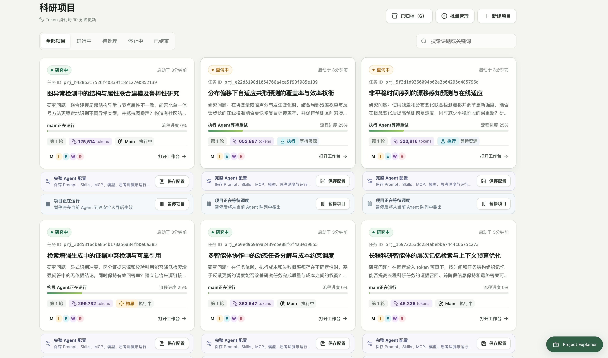</a>
  <a href="docs/readme/screenshots/project-execution.png">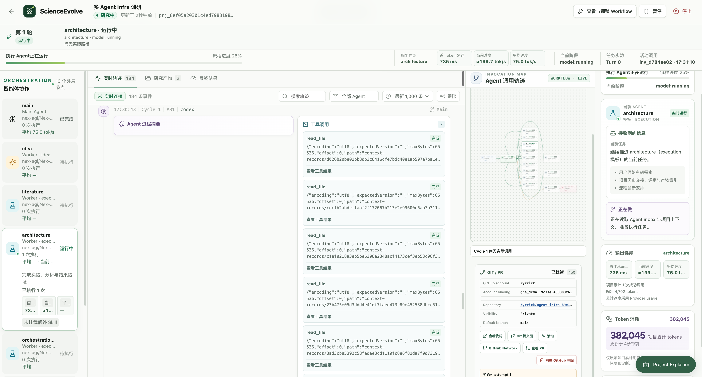</a>
  <a href="docs/readme/screenshots/workflow-editor.png">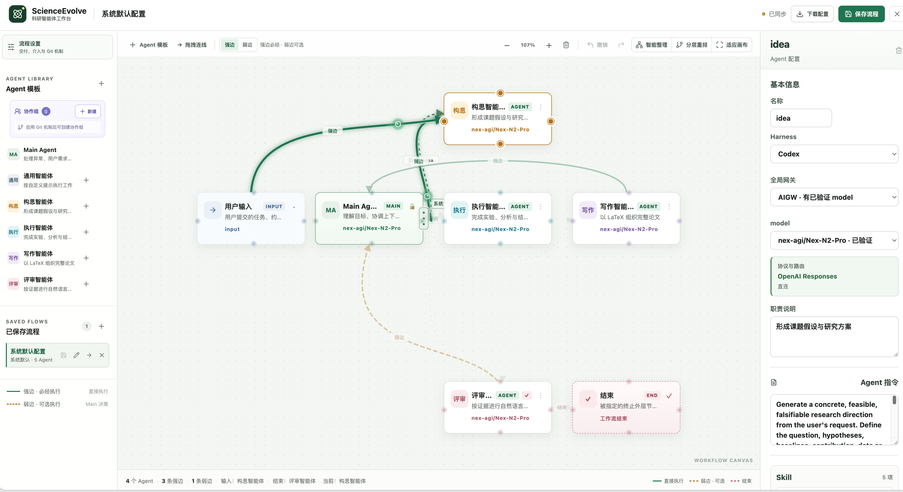</a>
  <br>
  <sub>Project overview &nbsp; · &nbsp; Runtime Monitoring &nbsp; · &nbsp; Workflow editor</sub>
</p>

---

ScienceEvolve is the autonomous version of the research framework presented in [Rethinking Scientific Discovery in the Agentic Era](https://arxiv.org/abs/2607.03863). It connects research, experiments, coding, and review in a visual workflow. Build an Agent team, follow its execution, improve the task using real feedback, and authorize Main to evolve the workflow itself.

<a id="sdk"></a>

**🧩 Two ways to use ScienceEvolve** — shared workflow semantics, with an interface for your way of working.

[](https://github.com/OpenMOSS/ScienceEvolve-server) — **Web / Server repository.** Compose Agents visually, connect model gateways, manage research projects, and inspect traces and delivered files.

[](https://github.com/OpenMOSS/ScienceEvolve) — **SDK / CLI repository.** Run workflows from TypeScript or the command line and embed research in your own services. See the [SDK examples](https://github.com/OpenMOSS/ScienceEvolve/blob/main/example/README.md) and [Web / SDK boundaries](docs/main-sdk-parity.md).

## Your research team, one workflow

> “Here is a Poisson solver. Explore two improvements, validate convergence, compare the errors, and write a report.”

Connect planning, parallel exploration, implementation, and review on the canvas. Main coordinates the work and confirms completion; Workers handle research, experiments, coding, and review. Each Agent can select **Codex, Claude Code, DSH, or pi**, with its own model, prompt, Skills, and MCP tools.

<div align="center">

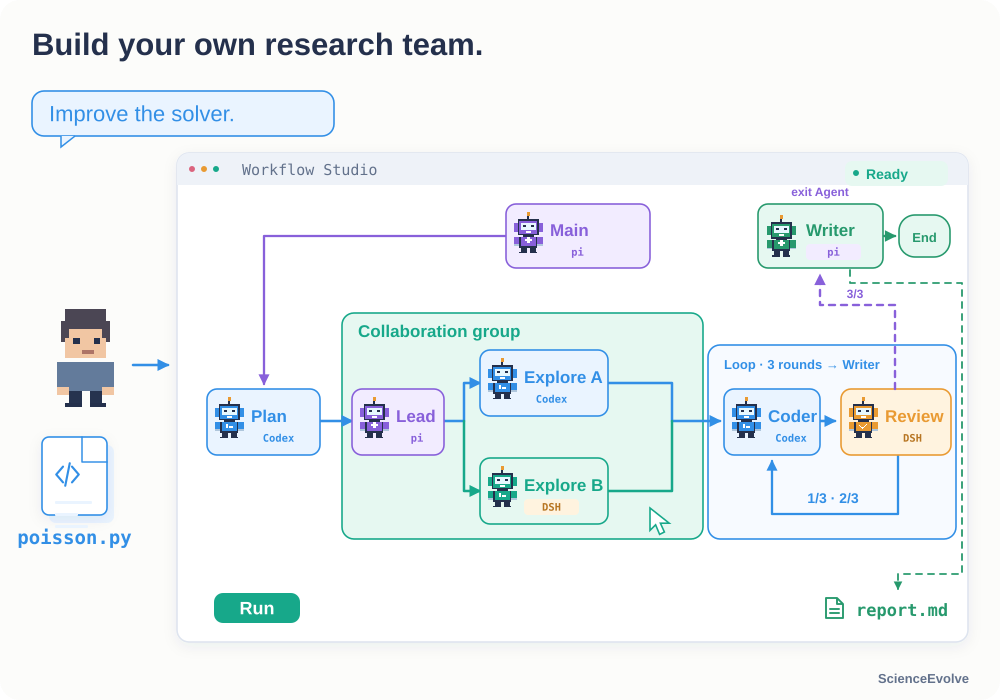

</div>

<a id="dual-loops"></a>

## Two feedback loops: improve the task and the process

The **task loop** runs a method, collects real feedback, improves the method, and runs again. The **process loop** reviews the research results and updates Agent responsibilities, tools, or routing before continuing. Start with a fixed workflow and enable process evolution when needed.

<div align="center">

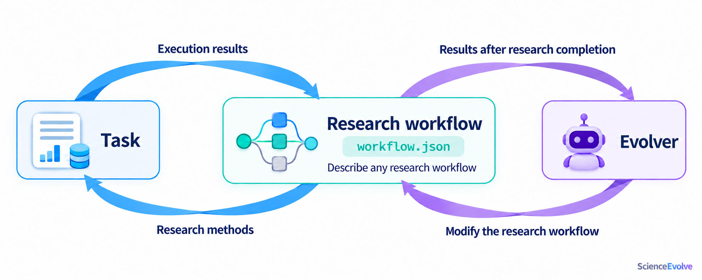

</div>

**Evolver is part of the team.** In the current implementation, Main takes this role when authorized to reconfigure dynamically. Main submits `workflow.json` and calls `apply_workflow`; Server validates the proposal before applying it. Actual task evaluation determines whether the change helps.

<div align="center">


</div>

[Main / Worker roles and dual loops](docs/research-workflows.md#dual-loops) · [Dynamic reconfiguration scope](docs/configuration.md#workflow)

<a id="skills-overview"></a>

## 🧠 Research Skills

ScienceEvolve distills methods from published research into **reusable scientific workflows**. Agents can frame a research question, formulate hypotheses, design validation, analyze evidence, and adapt their next steps to the results, bringing domain methods into their own research process.

**875 scientific methods across 12 research areas, distilled from 70,000+ published papers.**

- **🧭 Research design**: define applicability and required inputs, organize testable hypotheses, variables, controls, and research steps, and specify expected outputs.
- **🔎 Evidence and validation**: establish validation gates and claim boundaries, distinguishing verified facts, inferences, and untested hypotheses so conclusions remain tied to evidence.
- **🔄 Feedback and iteration**: identify failure modes and define when to repeat validation, revise the study, or pivot if evidence is insufficient or observations contradict a hypothesis.

Select task-relevant Skills for different Agents and provide the research goal, existing evidence, and available resources to guide research planning and result analysis. **The reusable part is the research method; conclusions still require evidence and validation from the current study.**

<p>
<a href=".agents/skills/scientific/immune-recognition/README.md#top"></a>
<a href=".agents/skills/scientific/aqueous-batteries/README.md#top"></a>
<a href=".agents/skills/scientific/asymmetric-catalysis/README.md#top">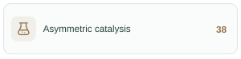</a>
<br>
<a href=".agents/skills/scientific/chromatin-regulation/README.md#top">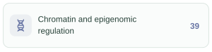</a>
<a href=".agents/skills/scientific/quantum-materials/README.md#top">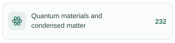</a>
<a href=".agents/skills/scientific/fiber-composites/README.md#top">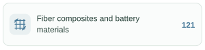</a>
<br>
<a href=".agents/skills/scientific/cosmology/README.md#top"></a>
<a href=".agents/skills/scientific/fusion/README.md#top"></a>
<a href=".agents/skills/scientific/neuromorphic-computing/README.md#top">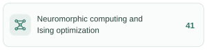</a>
<br>
<a href=".agents/skills/scientific/organometallic-catalysis/README.md#top"></a>
<a href=".agents/skills/scientific/polymer-composites/README.md#top"></a>
<a href=".agents/skills/scientific/urban-resilience/README.md#top"></a>
</p>

<sub>Browse Skills by area &nbsp; · &nbsp; <a href="#scientific-skills">Usage and examples</a> &nbsp; · &nbsp; <a href=".agents/skills/README.md#top">All Skills</a></sub>

<a id="features"></a>

## Features

### Let Main evolve the workflow

Authorized Main can add or remove Agents, change responsibilities and paths, switch Harnesses, and submit an updated workflow. Server validates before applying the proposal so the team can adapt to the task. [Editable scope](docs/configuration.md#workflow).

<div align="center">

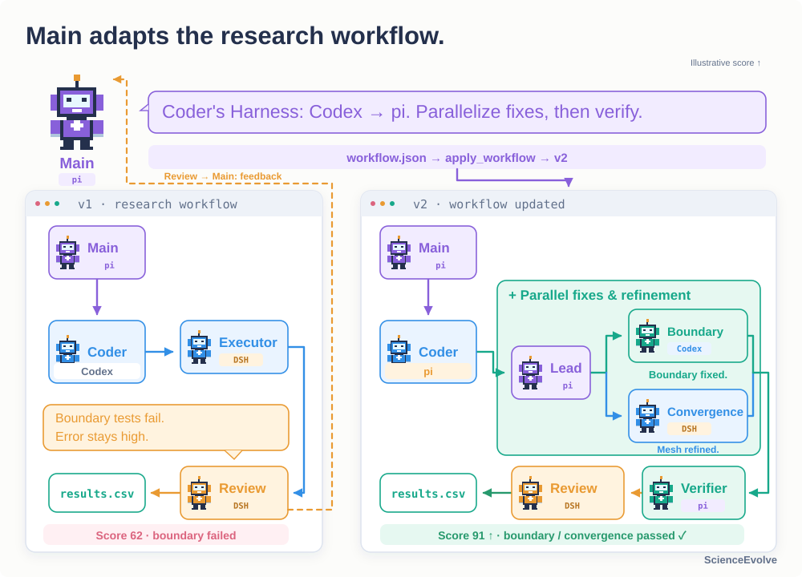

</div>

### Set Loop rounds and the exit Agent

Main starts a finite-element mesh convergence experiment. Coder → Executor → Review runs for three complete rounds, then exits to the selected Writer Agent, which delivers the error analysis report (errors.md). Both the number of rounds and exit Agent are configurable.

<div align="center">

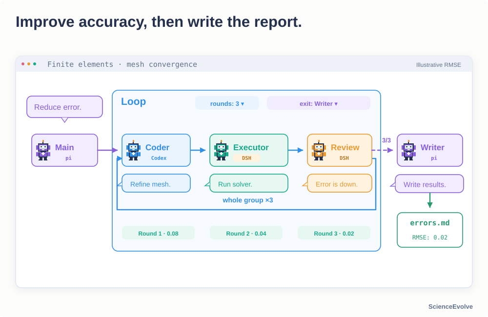

</div>

### Revert and retry from experiment evidence

Idea proposes a larger simulation time step. Execution implements and merges it, but evaluation regresses. Review directly reverts the merged candidate, restores the accepted code, and reruns the benchmark. The revert is a new commit; the failed change remains in history.

<div align="center">

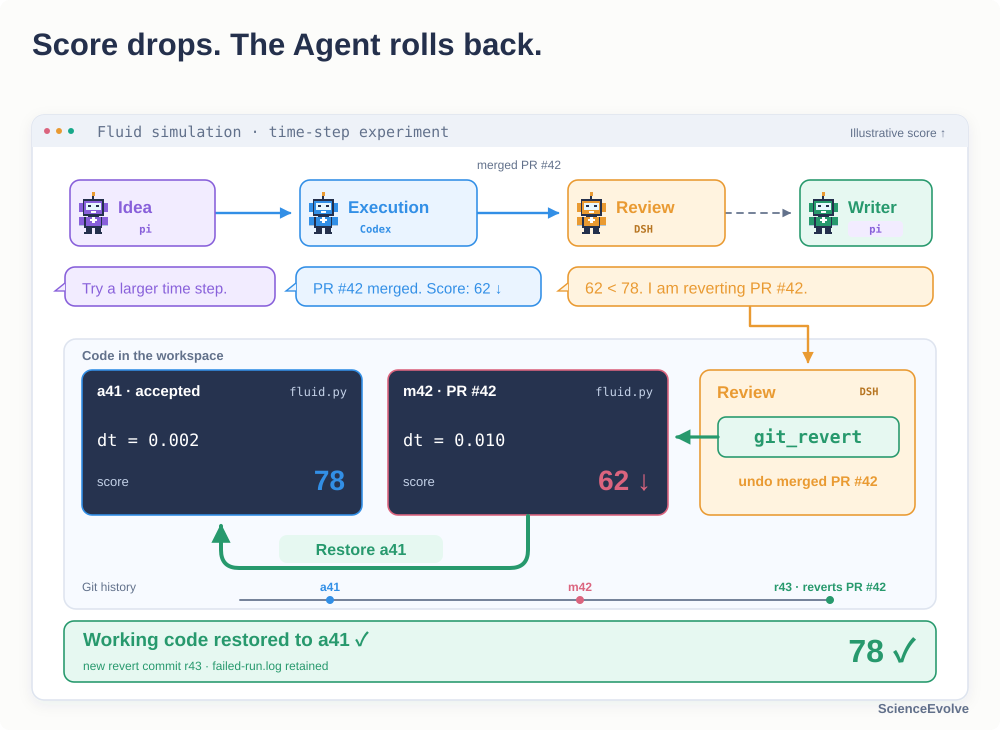

</div>

### Review and integrate parallel contributions

With Git collaboration enabled, Agents work in isolated worktrees. Collaboration groups organize parallel exploration, with review and PR integration at each level. [Configure a GitHub account](docs/configuration.md#github-accounts-and-git-collaboration).

<div align="center">

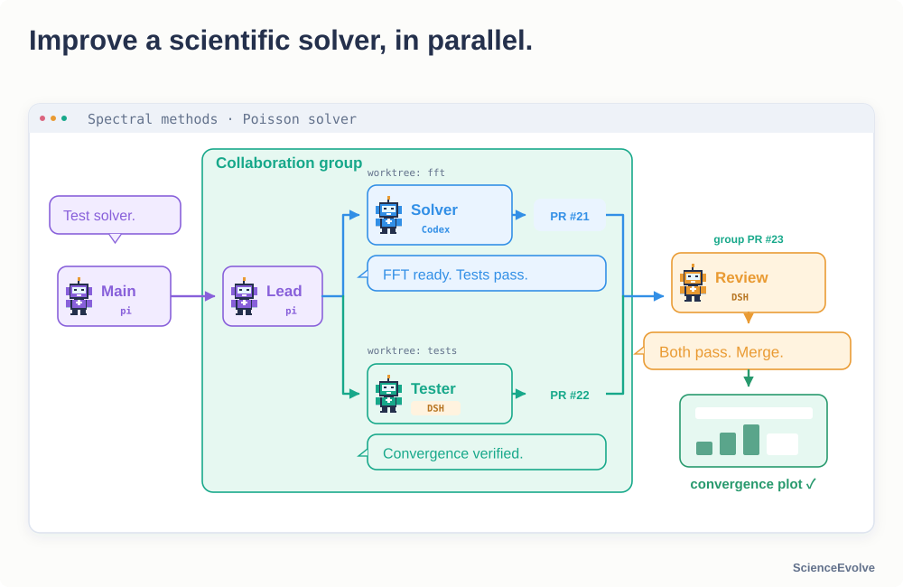

</div>

### Resume interrupted work

System Runtime retains project state, completed progress, and execution traces. Recoverable interruptions can resume through review and delivery. Check actual external processes and results before continuing external jobs.

<div align="center">

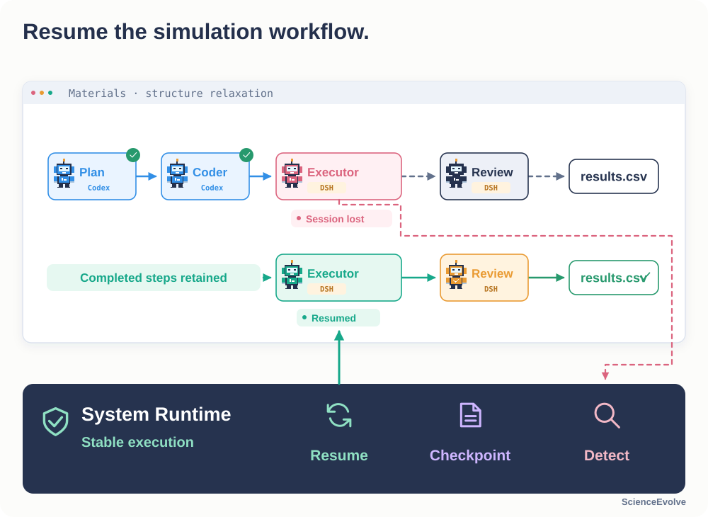

</div>

### Keep adjusting in natural language

Use **Project Explainer** to understand the current workflow, edit Agent settings, and add Loops or collaboration groups. Running-project edits pass through the [workflow update mechanism](docs/configuration.md#configuration-recommendations-and-project-explainer), preserving the version accepted by Server.

<div align="center">

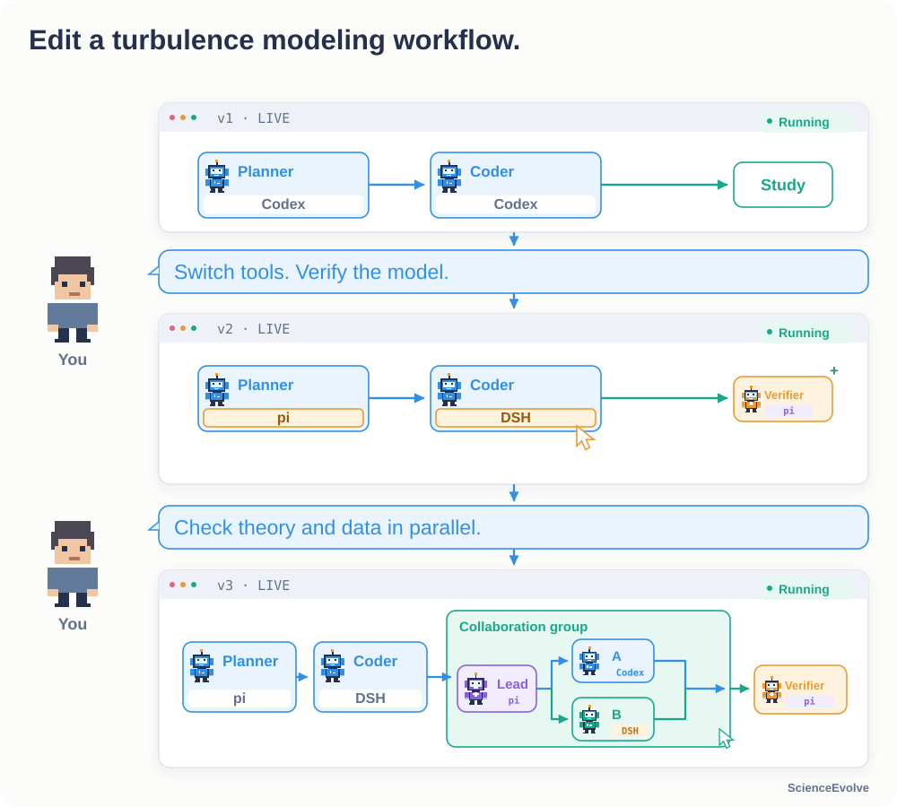

</div>

<a id="scientific-skills"></a>

## Skill usage and examples

**875 scientific method Skills across 12 areas, plus 21 supporting Skills for research and writing.**

<a id="scientific-methods"></a>

### Scientific methods · 12 areas / 875 Skills

The methods cover hypothesis generation, research design, experimental validation, evidence analysis, and iteration. Browse each area using the category cards above.

Each Skill defines applicability, inputs, steps, outputs, validation gates, claim boundaries, and failure handling. Categories organize browsing; existing `builtin:<name>` references remain unchanged.

<details>
<summary><strong>Inside a Skill: asymmetric catalysis research design</strong></summary>

The [chiral catalyst research-design Skill](.agents/skills/scientific/asymmetric-catalysis/sci-catalysis-asymmetric-catalysis-chiral-catalyst-rese-1571cd89/SKILL.md) guides an Agent through:

> Frame the problem → generate competing hypotheses → design minimal validation → analyze evidence → iterate or pivot.

It asks for the target transformation, existing evidence, candidate mechanisms, and available analytical methods. Each stage defines a decision gate: when the evidence cannot distinguish hypotheses, revisit the validation design; when the observations conflict with the mechanism, revise the hypothesis. Outputs include a research plan, controls, decision criteria, and bounded conclusions.

</details>

**Use in the Web editor:** select an Agent and add the relevant Skills through its existing Skills control. Choose fixed loading or automatic selection where supported by the Harness. Skills are included with the project; no separate download is needed.

When Main is authorized to reconfigure the workflow, it can adjust Skill selections as the research progresses. Actual data, tools, and experimental environments are configured for the task.

[Browse all research areas](.agents/skills/scientific/README.md#top)

<a id="general-skills"></a>

### Supporting research & writing Skills · 21

Research direction, ideation, literature research, experiment design, writing, figures, and review, plus Inspire experiment guidance.

- **Team roles · 5**: research direction, ideation, experiment execution, writing, and review.
- **Research, writing, and review · 15**: CCFA, Nature-style, and integrated writing methods.
- **Experiment operations · 1**: Inspire operations and experiment resources.

[Browse research & writing Skills](.agents/skills/general/README.md#top)

<a id="quick-start"></a>

## Quick start

You need **Node.js 24+**, **npm 10+**, an installed [Inspire CLI](.agents/skills/general/inspire/references/setup/install-and-config.md#1-安装), and a working model gateway. The current Server checks for Inspire at startup, including for local tasks.

### 1. Install and start

Copy this repository's HTTPS clone address from **Code → HTTPS** and replace `REPOSITORY_URL` below:

```bash
git clone REPOSITORY_URL ScienceEvolve
cd ScienceEvolve
npm ci
npm ci --prefix harness/codex
cp .env.example .env
```

When using the default `./data`, set `SCIENCEEVOLVE_INSPIRE_WORKSPACE_ROOT` in `.env` to the absolute repository path. Set `SCIENCEEVOLVE_INSPIRE_BIN` to the executable's absolute path if Inspire is not on `PATH`. Keep your existing `.env` when updating an installation.

```bash
npm run dev
```

Open **<http://127.0.0.1:5173>**. The [API health endpoint](http://127.0.0.1:4311/api/health) should return JSON containing `"status":"ok"`. See [setup and configuration](docs/configuration.md#quick-start) for other Harnesses, environment variables, and deployment options.

### 2. Connect a model

Open **“全局网关库” (global gateway library)**, enter your model service's HTTPS endpoint and API key, select its protocol and available models, save it, and set it as default. Click **“测试连接” (test connection)** and validate your intended Harness/model combination in the matrix. Each Agent's model and reasoning option must be supported by that gateway.

### 3. Import a Workflow manually

The repository's [example/](example/README_en.md) directory retains Workflow JSON files, requirements, and reference assets. The application does not load these workflows automatically. On the machine running Server, manually export a Web-compatible copy:

```bash
node example/export-web-workflow.mjs \
  example/02-software-development/workflow.json /tmp/software.web.json
```

On the homepage, click **“导入 SDK workflow.json” (import SDK workflow.json)**, select the exported file, and inspect the preview. Close it, select the imported entry under **“快速发起研究任务 → Agent 配置预设” (quick launch → Agent preset)**, and paste the [software requirement](example/02-software-development/requirement.txt). Choose an available Harness, gateway, and model for every Agent, leave parallel collaboration off, and click **“提交并继续” (submit and continue)**.

After completion, inspect the code, usage instructions, and actual test records in `development/final.md`. The collapsed tutorial covers the full import flow. Use the [SDK guide](https://github.com/OpenMOSS/ScienceEvolve/blob/main/sdk/README.md) for SDK execution.

<a id="tutorial"></a>

## Web tutorial: from a first task to your own workflow

Use generic JSON import, the Workflow canvas, Agent settings, and Project Explainer to turn a requirement into an executable configuration. Complete a small task first, then introduce Loops, parallel collaboration, and workflow evolution. UI labels below match the current Chinese interface.

<details>
<summary><strong>① Run a real project: build and test a Node.js Todo CLI</strong></summary>

### Import the workflow and prepare the requirement

1. Use the command above to export the [original Workflow](example/02-software-development/workflow.json) as a separate `software.web.json`. The script supplies Web format fields, removes top-level deployment settings, and resolves Skill paths. It preserves the original; requirements remain separate. Choose another filename if the output already exists.
2. Click **“导入 SDK workflow.json”** on the homepage and select the export. Inspect coding, testing, and Main in the original read-only preview, then close it.
3. Select the imported entry under **“快速发起研究任务 → Agent 配置预设”** to load an editable copy. Paste [requirement.txt](example/02-software-development/requirement.txt) into **“研究任务需求” (research requirement)**. Keep the checks for `add / list / done / remove`, JSON persistence, corrupt-file protection, and error exit codes.
4. To upload existing code, first use **“保存 → 另存为新配置” (save → save as new)** in quick launch. Open **“新建项目” (new project)** and select that configuration. Upload through **“补充文件与图片” → “选择文件或图片 / 选择文件夹”**; inputs appear under `user_inputs/`. This page starts with **“创建并启动研究” (create and start research)**.

### Check routing and models on the canvas

This is the actual read-only canvas opened through generic JSON import, before connecting models or starting research. Close the preview, select the import in quick launch, then click **“打开 Workflow 画布编辑器” (open Workflow canvas editor)** to edit a copy.

<div align="center">

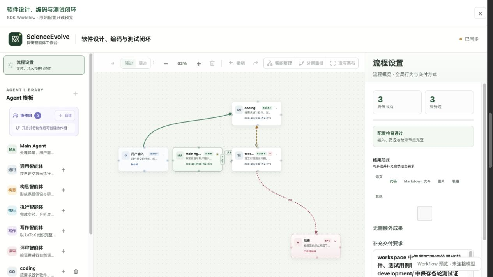

</div>

```text
User input → coding → testing → pass: complete
                ↑        │
                └─ fail ─┘
Main: coordinate recovery and additional user input
```

- Select coding or testing and check **Harness, 全局网关 (global gateway), model, 网关思考强度 (gateway reasoning)** in **“Agent 属性面板”**. Main also needs a valid configuration. A model name in a template does not grant access to that model.
- coding → testing is a strong edge. testing chooses repair or completion based on real test results. It is the designated terminal Agent with automatic completion explicitly enabled. An edge to finish alone does not mark a task successful.
- This starter retries conditionally and **has no fixed-iteration Loop**. Keep parallel collaboration and Main's automatic workflow changes off for now. Use **“保存流程” (save workflow)** to return and save a configuration as needed. The imported original stays read-only.
- **“推荐配置” (recommend configuration)** is optional. If it or Project Explainer changes a named method, review the roles, paths, and acceptance conditions again.

### Start, follow execution, and inspect the files

Click **“提交并继续”** on the homepage. Follow coding's implementation, testing's independent checks, and any failure handoff. If using the new-project page, start with **“创建并启动研究”**. **“保存课题” (save project draft)** saves without starting the task.

Expected deliverables are a working `cli.mjs`, Node built-in tests, usage instructions, and test evidence plus `final.md` under `development/`. Tests should use temporary directories and `TODO_DATA_FILE`, covering persistence, blank input, repeated done, unknown IDs, corrupt JSON, and invalid arguments. Completion requires actual passing checks on the delivered version; inspect this run's files and recorded commands.

For a recoverable interruption, inspect the status, cause, and existing traces before using **“暂停项目” (pause project) / “启动项目” (start project)**. Interrupted projects offer **“启动并恢复” (start and recover)**. Recovery preserves completed progress; check real external jobs and tool processes before continuing them.

[Full software workflow protocol](example/02-software-development/README.md) · [Workspaces and artifacts](docs/configuration.md#workspaces-and-artifact-integrity)

</details>

<details>
<summary><strong>② Compose a Workflow: Agents, edges, Loops, collaboration, and live adjustments</strong></summary>

### Add an Agent and configure its capabilities

Select a template under **“Agent 模板” (Agent templates)** and add a copy. Select its node to edit responsibilities, instructions, Harness, model, Skills, and MCP tools. Main is required and unique; it cannot be deleted or renamed. Connect new Workers' business paths yourself. Main's fixed dispatch edges are maintained by the system.

Gateways, installed Harnesses, Skill files, and MCP services must actually be available. Upload task inputs through the Web UI. Prepare GPUs, experiment platforms, or wet-lab services required by a particular example before running it.

### Connect paths and define who verifies completion

Drag from a node port, or select **“连接目标” (connection target) → “添加连接” (add connection)** in its settings:

<table>
<thead>
<tr><th align="left">Setting</th><th align="left">How to use it</th></tr>
</thead>
<tbody><tr><td align="left">Strong edge</td><td align="left">Proceed directly to a single target; it cannot be mixed with other outgoing candidates.</td></tr>
<tr><td align="left">Weak edge</td><td align="left">Offer alternative targets selected by the configured Main or current Worker; useful for repair and branching.</td></tr>
<tr><td align="left">Terminal Agent</td><td align="left">Main verifies completion by default. A different terminal Agent can complete only with explicit automatic-completion permission in a valid context. Define the required evidence.</td></tr>
</tbody></table>

### Understand Loop batches with AHE

Use the same manual export/import steps to load [AHE code evolution](example/01-ahe-evolve/workflow.json). Its strong-edge cycle is `optimizer → execute → judge → optimizer`. Closing a valid cycle creates a Loop without adding a Loop node. Select any member edge to edit the Loop ID, iterations per batch, and exit target on the right.

This example uses:

```json
{
  "id": "code_evolution",
  "from": "judge",
  "to": "optimizer",
  "maxIterations": 3,
  "exitTo": "main"
}
```

This means **up to three iterations per batch, then return to Main**. Main checks the original target and either completes or starts another batch at optimizer. It is not a project-wide limit of three iterations. The dashed `from → exitTo` edge is a read-only batch exit; it does not run every iteration. Pause, recovery, and retries preserve batch, iteration, and total counters. Breaking the cycle removes its Loop configuration.

### Enable Git collaboration for parallel development

Configure **“GitHub 账号” (GitHub account)**, enable **“并行协作模式” (parallel collaboration)**, and create a group. Choose an existing Agent as Leader and reference other Agents as business nodes. Click the group to edit its internal Workflow; use breadcrumbs or **“返回父图” (return to parent)** to navigate back. Only edges from the group entry create parallel paths. Internal workflows can use strong/weak edges, Loops, and nested groups.

References to the same Agent share configuration, session, and directory, with calls serialized in a queue; different Agents can run concurrently. Completing a group waits for required paths and Git integration. PR merging and local synchronization at each level must finish before successors run. See [Git account configuration](docs/configuration.md#github-accounts-and-git-collaboration) and [scoped collaboration workflows](docs/openfars-collaboration/scoped-workflow-v3-en.md).

### Save, adjust, and recover

Use **“智能整理 / 分层重排 / 适应画布” (tidy / layered layout / fit canvas)** to inspect the whole graph. Save with **“更新当前配置 / 仅本次项目使用 / 另存为新配置” (update current / this project only / save as new)**. The imported original is read-only; save edits as your own configuration.

**Project Explainer** helps edit drafts, explain workflows, and submit allowed runtime changes. To let Main change orchestration autonomously, enable **“允许 Main 动态重配置（高级权限）” (allow Main dynamic reconfiguration)** before creation. Authorized Main turns submit `workflow.json` and call `apply_workflow` for validation. Credentials, execution permissions, session/reasoning policies, and the authorization switch remain locked. Accepted Skill/MCP content cannot be overwritten under the same name; add a definition and update references for a new version.

Use the Server's accepted configuration and actual traces as the runtime source of truth. Pausing, submitting an update, and recovering are separate actions. See the complete [Workflow scope](docs/configuration.md#workflow) and [Project Explainer guide](docs/configuration.md#configuration-recommendations-and-project-explainer).

</details>

<a id="examples"></a>

## Examples

We implement or adapt workflow structures from published papers and open-source projects as ScienceEvolve configurations, including Agent roles, routing, and feedback loops. Credit belongs to the original authors; the table links the **original work, official project, and our implementation**.

This page presents **21 workflow examples, including three introductory workflows**. Their files are indexed under [example/](example/README_en.md). They are provided as JSON configurations, reference assets, and documentation. Web users copy, export, and import them manually. The application has no dedicated template gallery, automatic loading, or Server packaging for these examples.

### Start with three introductory workflows

[Software development and testing](example/02-software-development/README.md) — coding, independent testing, and repair. · [AHE code evolution](example/01-ahe-evolve/README.md) — execution, evaluation, optimization, and batch decisions. · [General research](example/dynamic-research-workflow/README.md) — ideation, execution, writing, review, and Main coordination.

### Workflows from papers and open-source projects

<table>
<thead>
<tr><th align="left">Method</th><th align="left">Original paper</th><th align="left">Official code / project</th><th align="left">Our workflow</th></tr>
</thead>
<tbody><tr><td align="left"><a href="example/01-ahe-evolve/README.md">AHE code evolution</a></td><td align="left"><a href="https://arxiv.org/abs/2604.25850" title="Agentic Harness Engineering: Observability-Driven Automatic Evolution of Coding-Agent Harnesses">arXiv:2604.25850</a></td><td align="left"><a href="https://github.com/china-qijizhifeng/agentic-harness-engineering">agentic-harness-engineering</a></td><td align="left"><a href="example/01-ahe-evolve/workflow.json">JSON</a> · <a href="docs/readme/workflows/01-ahe-evolve.jpg">Canvas</a></td></tr>
<tr><td align="left"><a href="example/aris/README.md">ARIS</a></td><td align="left"><a href="https://arxiv.org/abs/2605.03042" title="ARIS: Autonomous Research via Adversarial Multi-Agent Collaboration">arXiv:2605.03042</a></td><td align="left"><a href="https://github.com/wanshuiyin/Auto-claude-code-research-in-sleep" title="wanshuiyin/Auto-claude-code-research-in-sleep">ARIS</a></td><td align="left"><a href="example/aris/workflow.json">JSON</a> · <a href="docs/readme/workflows/aris.jpg">Canvas</a></td></tr>
<tr><td align="left"><a href="example/metaharness/README.md">Meta-Harness</a></td><td align="left"><a href="https://arxiv.org/abs/2603.28052" title="Meta-Harness: End-to-End Optimization of Model Harnesses">arXiv:2603.28052</a></td><td align="left"><a href="https://github.com/stanford-iris-lab/meta-harness">meta-harness</a></td><td align="left"><a href="example/metaharness/workflow.json">JSON</a> · <a href="docs/readme/workflows/metaharness.jpg">Canvas</a></td></tr>
<tr><td align="left"><a href="example/autoresearch/README.md">autoresearch</a></td><td align="left">— (project source)</td><td align="left"><a href="https://github.com/karpathy/autoresearch">autoresearch</a></td><td align="left"><a href="example/autoresearch/workflow.json">JSON</a> · <a href="docs/readme/workflows/autoresearch.jpg">Canvas</a></td></tr>
<tr><td align="left"><a href="example/funsearch/README.md">FunSearch</a></td><td align="left"><a href="https://www.nature.com/articles/s41586-023-06924-6" title="Mathematical discoveries from program search with large language models">Nature 2023</a></td><td align="left"><a href="https://github.com/google-deepmind/funsearch">funsearch</a></td><td align="left"><a href="example/funsearch/workflow.json">JSON</a> · <a href="docs/readme/workflows/funsearch.jpg">Canvas</a></td></tr>
<tr><td align="left"><a href="example/agent-laboratory/README.md">Agent Laboratory</a></td><td align="left"><a href="https://arxiv.org/abs/2501.04227" title="Agent Laboratory: Using LLM Agents as Research Assistants">arXiv:2501.04227</a></td><td align="left"><a href="https://github.com/SamuelSchmidgall/AgentLaboratory">AgentLaboratory</a></td><td align="left"><a href="example/agent-laboratory/workflow.json">JSON</a> · <a href="docs/readme/workflows/agent-laboratory.jpg">Canvas</a></td></tr>
<tr><td align="left"><a href="example/sciagents/README.md">SciAgents</a></td><td align="left"><a href="https://arxiv.org/abs/2409.05556" title="SciAgents: Automating scientific discovery through multi-agent intelligent graph reasoning">arXiv:2409.05556</a></td><td align="left"><a href="https://github.com/lamm-mit/SciAgentsDiscovery">SciAgentsDiscovery</a></td><td align="left"><a href="example/sciagents/workflow.json">JSON</a> · <a href="docs/readme/workflows/sciagents.jpg">Canvas</a></td></tr>
<tr><td align="left"><a href="example/robin/README.md">Robin</a></td><td align="left"><a href="https://arxiv.org/abs/2505.13400v1" title="Robin: A multi-agent system for automating scientific discovery">arXiv:2505.13400</a></td><td align="left"><a href="https://github.com/Future-House/robin">robin</a></td><td align="left"><a href="example/robin/workflow.json">JSON</a> · <a href="docs/readme/workflows/robin.jpg">Canvas</a></td></tr>
<tr><td align="left"><a href="example/co-scientist/README.md">Google AI co-scientist</a></td><td align="left"><a href="https://arxiv.org/abs/2502.18864v1" title="Towards an AI co-scientist">arXiv:2502.18864</a></td><td align="left">— †</td><td align="left"><a href="example/co-scientist/workflow.json">JSON</a> · <a href="docs/readme/workflows/co-scientist.jpg">Canvas</a></td></tr>
<tr><td align="left"><a href="example/biomni/README.md">Biomni A1 / E1</a></td><td align="left"><a href="https://www.biorxiv.org/content/10.1101/2025.05.30.656746v1" title="Biomni: A General-Purpose Biomedical AI Agent">bioRxiv 2025</a></td><td align="left"><a href="https://github.com/snap-stanford/Biomni">Biomni</a></td><td align="left"><a href="example/biomni/workflow.json">JSON</a> · <a href="docs/readme/workflows/biomni.jpg">Canvas</a></td></tr>
<tr><td align="left"><a href="example/agentrxiv/README.md">AgentRxiv</a></td><td align="left"><a href="https://arxiv.org/abs/2503.18102" title="AgentRxiv: Towards Collaborative Autonomous Research">arXiv:2503.18102</a></td><td align="left"><a href="https://github.com/SamuelSchmidgall/AgentLaboratory">AgentLaboratory</a></td><td align="left"><a href="example/agentrxiv/workflow.json">JSON</a> · <a href="docs/readme/workflows/agentrxiv.jpg">Canvas</a></td></tr>
<tr><td align="left"><a href="example/rrsi/README.md">RRSI</a></td><td align="left"><a href="https://arxiv.org/abs/2609.24972" title="RRSI: Regularized Recursive Self-Improvement of Agent Harnesses">arXiv:2609.24972</a></td><td align="left"><a href="https://github.com/google-research/rrsi">rrsi</a></td><td align="left"><a href="example/rrsi/workflow.json">JSON</a> · <a href="docs/readme/workflows/rrsi.jpg">Canvas</a></td></tr>
<tr><td align="left"><a href="example/drugevolve/README.md">DrugEvolve</a></td><td align="left"><a href="https://www.biorxiv.org/content/10.64898/2026.08.16.745117v1" title="An AI System for Autonomous Algorithm Evolution in Drug Development">bioRxiv 2026</a></td><td align="left"><a href="https://github.com/GAIR-NLP/DrugEvolve">DrugEvolve</a></td><td align="left"><a href="example/drugevolve/workflow.json">JSON</a> · <a href="docs/readme/workflows/drugevolve.jpg">Canvas</a></td></tr>
<tr><td align="left"><a href="example/scientist-two/README.md">ScientistTwo</a></td><td align="left"><a href="https://arxiv.org/abs/2609.19644v1" title="ScientistTwo: Pioneering the Human Knowledge Frontier with Autonomous AI">arXiv:2609.19644</a></td><td align="left">— †</td><td align="left"><a href="example/scientist-two/workflow.json">JSON</a> · <a href="docs/readme/workflows/scientist-two.jpg">Canvas</a></td></tr>
<tr><td align="left"><a href="example/ai-scientist-v2/README.md">AI Scientist v2</a></td><td align="left"><a href="https://arxiv.org/abs/2504.08066" title="The AI Scientist-v2: Workshop-Level Automated Scientific Discovery via Agentic Tree Search">arXiv:2504.08066</a></td><td align="left"><a href="https://github.com/SakanaAI/AI-Scientist-v2">AI-Scientist-v2</a></td><td align="left"><a href="example/ai-scientist-v2/workflow.json">JSON</a> · <a href="docs/readme/workflows/ai-scientist-v2.jpg">Canvas</a></td></tr>
<tr><td align="left"><a href="example/internagent-1-5/README.md">InternAgent 1.5</a></td><td align="left"><a href="https://arxiv.org/abs/2602.08990" title="InternAgent-1.5: A Unified Agentic Framework for Long-Horizon Autonomous Scientific Discovery">arXiv:2602.08990</a></td><td align="left"><a href="https://github.com/InternScience/InternAgent">InternAgent</a></td><td align="left"><a href="example/internagent-1-5/workflow.json">JSON</a> · <a href="docs/readme/workflows/internagent-1-5.jpg">Canvas</a></td></tr>
<tr><td align="left"><a href="example/biomni-r0/README.md">Biomni-R0</a></td><td align="left"><a href="https://biomni.stanford.edu/blog/biomni-r0-technical-report" title="Biomni-R0 technical report">Technical report</a></td><td align="left"><a href="https://github.com/snap-stanford/Biomni">Biomni</a></td><td align="left"><a href="example/biomni-r0/workflow.json">JSON</a> · <a href="docs/readme/workflows/biomni-r0.jpg">Canvas</a></td></tr>
<tr><td align="left"><a href="example/chemical-coscientist/README.md">Chemical Coscientist</a></td><td align="left"><a href="https://www.nature.com/articles/s41586-023-06792-0" title="Autonomous chemical research with large language models">Nature 2023</a></td><td align="left"><a href="https://github.com/gomesgroup/coscientist">coscientist</a></td><td align="left"><a href="example/chemical-coscientist/workflow.json">JSON</a> · <a href="docs/readme/workflows/chemical-coscientist.jpg">Canvas</a></td></tr>
<tr><td align="left"><a href="example/raven/README.md">Raven Host</a></td><td align="left"><a href="https://arxiv.org/abs/2609.33439" title="Raven: The Harness of Harnesses for Composable Agentic Intelligence">arXiv:2609.33439</a></td><td align="left"><a href="https://github.com/EverMind-AI/Raven">Raven</a></td><td align="left"><a href="example/raven/workflow.json">JSON</a> · <a href="docs/readme/workflows/raven.jpg">Canvas</a></td></tr>
</tbody></table>

† Google AI co-scientist and ScientistTwo are independent implementations based on published papers and available components; the pinned sources do not provide the complete official systems. autoresearch uses the official project as its source. AgentRxiv code is included in Agent Laboratory. Each example records source versions, adaptation scope, and tool requirements.

**Scope: workflow structure and orchestration.** The table collects workflow configurations and adaptations; reproducing paper experiments or metrics is outside its scope. Each example documents its mapping and tool requirements. See [sources and adaptation scope](docs/research-workflows.md#research-papers-and-method-examples).

<details>
<summary><strong>Real Workflow canvases: software development / AHE code evolution</strong></summary>

These actual frontend screenshots were captured through the existing generic JSON importer. They show configuration only; no models or research tasks were started.

**Software development and testing** — coding implements, testing verifies independently, failures return for repair.

<div align="center">


</div>

**AHE code evolution** — execution, evaluation, and optimization, with Main deciding after each three-iteration batch.

<div align="center">

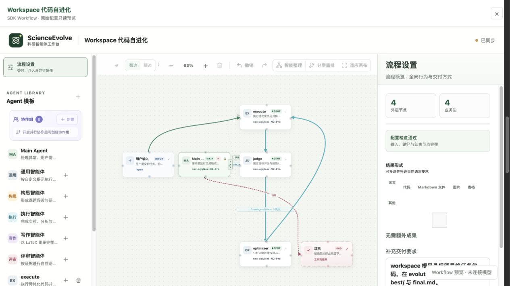

</div>

[21 Workflow canvas screenshots](docs/readme/workflows/README_en.md) · [Manual import instructions](example/README_en.md#manual-use-in-web)

</details>

[Complete example index](example/README_en.md) · [Sources, protocols, and validation](docs/research-workflows.md#research-papers-and-method-examples)

## Built-in Skill sources and acknowledgements

The Web UI and Server share the built-in Skills in [`.agents/skills`](.agents/skills). Their upstream repositories and uses are listed below.

<table>
<thead>
<tr><th align="left">Built-in Skill / resource</th><th align="left">Upstream repository</th><th align="left">Use in ScienceEvolve</th></tr>
</thead>
<tbody><tr><td align="left"><code>ccf-common</code>, <code>ccf-experiment-designer</code>, <code>ccf-idea-optimizer</code>, <code>ccf-idea-reviewer</code>, <code>ccf-literature-monitor</code>, <code>ccf-literature-searcher</code>, <code>ccf-paper-reviewer</code>, <code>ccf-paper-to-exemplar</code>, <code>ccf-paper-writer</code>, <code>ccf-visual-composer</code></td><td align="left"><a href="https://github.com/mikubaka88/CCFA-Skills">mikubaka88/CCFA-Skills</a></td><td align="left">Adapted research, writing, review, and visualization Skills.</td></tr>
<tr><td align="left"><code>nature-figure</code>, <code>nature-polishing</code>, <code>nature-shared</code>, <code>nature-writing</code></td><td align="left"><a href="https://github.com/Yuan1z0825/nature-skills">Yuan1z0825/nature-skills</a></td><td align="left">Integrated Nature-style writing, polishing, figures, and shared references.</td></tr>
<tr><td align="left"><code>awesome-ai-research-writing-director</code></td><td align="left"><a href="https://github.com/Leey21/awesome-ai-research-writing">Leey21/awesome-ai-research-writing</a></td><td align="left">Writing-method synthesis adapted to the manuscript output contract.</td></tr>
<tr><td align="left"><code>inspire</code></td><td align="left"><a href="https://github.com/realZillionX/InspireSkill">realZillionX/InspireSkill</a></td><td align="left">Platform guidance adapted to the SII MCP integration.</td></tr>
<tr><td align="left">Plotting references used by <code>nature-figure</code></td><td align="left"><a href="https://github.com/ChenLiu-1996/figures4papers">ChenLiu-1996/figures4papers</a></td><td align="left">Scientific figure design and plotting references.</td></tr>
</tbody></table>

Bundled Skills include ScienceEvolve-specific integration changes. The project role Skills `research-director`, `idea-agent`, `experiment-runner`, `latex-writer`, and `iclr-reviewer` are maintained in this repository. Thank you to the upstream authors and contributors.

The CCFA and Nature copies do not record import commits; their repository attribution is based on comparing Skill names and contents with upstream.

<a id="configuration"></a>

## Configure what you need

<table>
<thead>
<tr><th align="left">Your task</th><th align="left">Guide</th></tr>
</thead>
<tbody><tr><td align="left">Install, change ports/data directories, or deploy</td><td align="left"><a href="docs/configuration.md#quick-start">Setup</a> · <a href="docs/configuration.md#server-environment">Server environment</a> · <a href="docs/configuration.md#production">Production</a></td></tr>
<tr><td align="left">Connect models, select protocols, and test combinations</td><td align="left"><a href="docs/configuration.md#global-gateways">Global gateways</a></td></tr>
<tr><td align="left">Install another Harness or tune an Agent</td><td align="left"><a href="docs/configuration.md#harness">Harness</a> · <a href="docs/configuration.md#agent">Agent settings</a> · <a href="harness/README_en.md">Runtime guide</a></td></tr>
<tr><td align="left">Connect tools and add project resources</td><td align="left"><a href="docs/configuration.md#skills-and-mcp">Skills and MCP</a> · <a href="docs/inspire-async-experiments-en.md">Inspire/SII experiments</a></td></tr>
<tr><td align="left">Configure GitHub OAuth and nested parallel workflows</td><td align="left"><a href="docs/configuration.md#github-accounts-and-git-collaboration">Git accounts</a> · <a href="docs/openfars-collaboration/scoped-workflow-v3-en.md">Collaboration workflows</a></td></tr>
<tr><td align="left">Understand orchestration, permissions, recovery, and host differences</td><td align="left"><a href="docs/configuration.md#workflow">Workflow</a> · <a href="docs/architecture.md">Architecture</a> · <a href="docs/main-sdk-parity.md">Web / SDK boundaries</a></td></tr>
</tbody></table>

<a id="resources"></a>

## Additional documentation links

<table>
<thead>
<tr><th align="left">Document</th><th align="left">Link</th></tr>
</thead>
<tbody>
<tr><td align="left">Research workflows</td><td align="left"><a href="docs/research-workflows.md">Main / Worker roles, dual loops, and method sources</a></td></tr>
<tr><td align="left">SDK documentation</td><td align="left"><a href="https://github.com/OpenMOSS/ScienceEvolve/blob/main/sdk/README.md">SDK guide</a> · <a href="https://github.com/OpenMOSS/ScienceEvolve/blob/main/example/README.md">SDK examples</a></td></tr>
<tr><td align="left">Workflow files and manual import</td><td align="left"><a href="example/README_en.md">Example directory and import instructions</a></td></tr>
<tr><td align="left">Workflow canvas screenshots</td><td align="left"><a href="docs/readme/workflows/README_en.md">21 actual Workflow canvases</a></td></tr>
<tr><td align="left">Inspire CLI installation</td><td align="left"><a href=".agents/skills/general/inspire/references/setup/install-and-config.md">Installation and configuration</a></td></tr>
</tbody>
</table>
