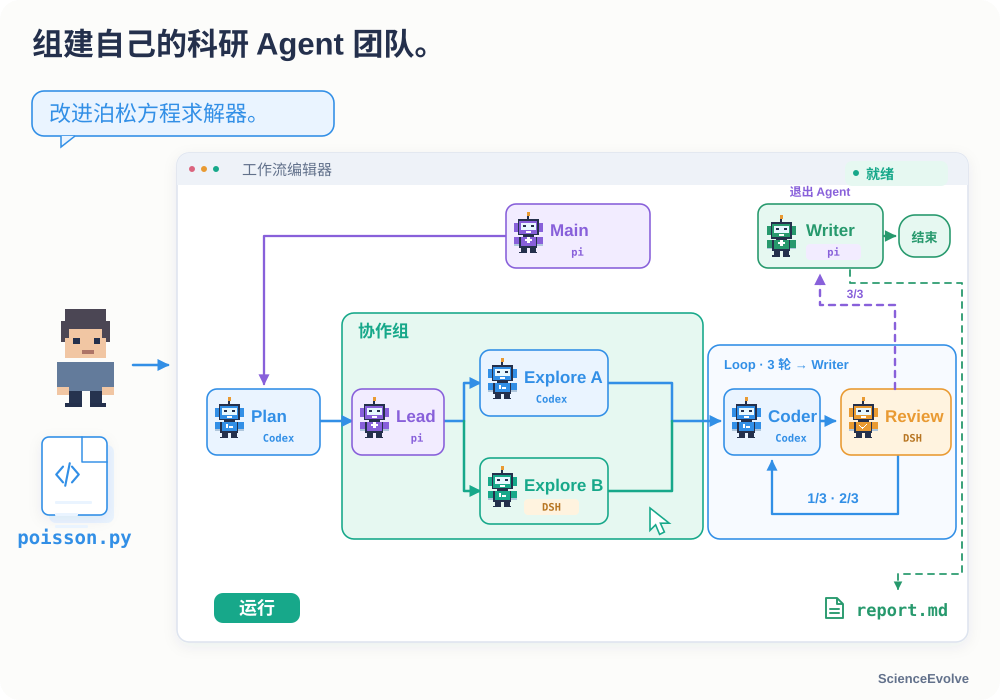
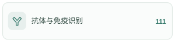
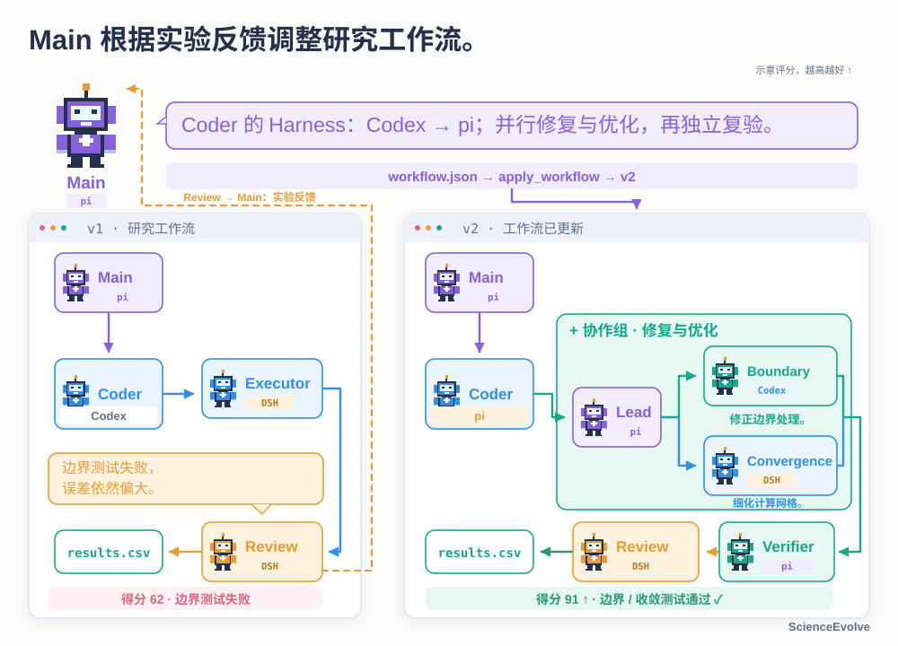
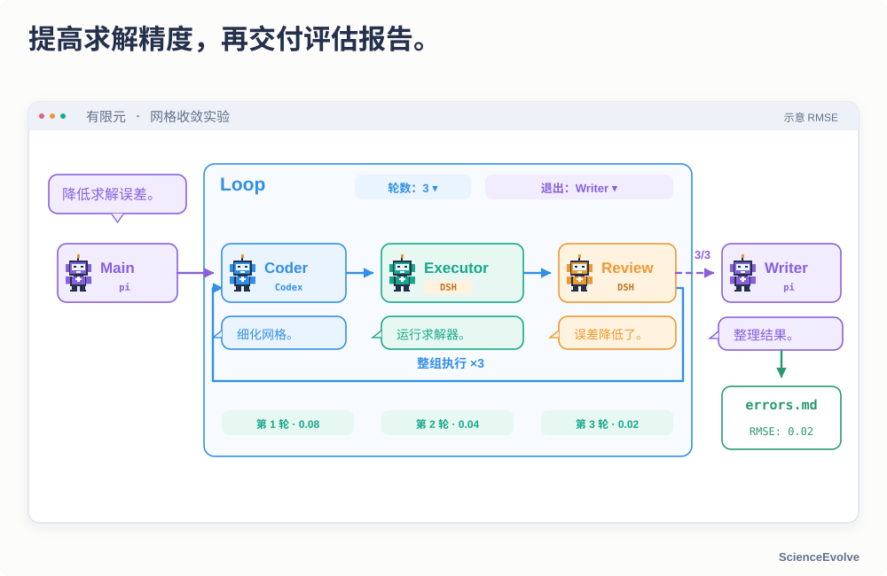
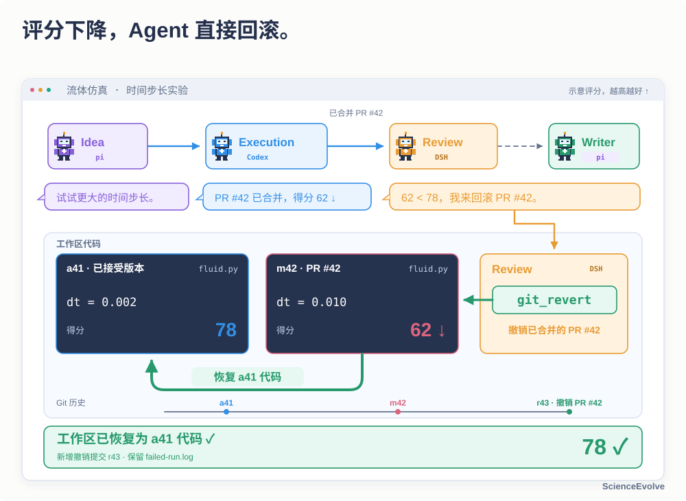
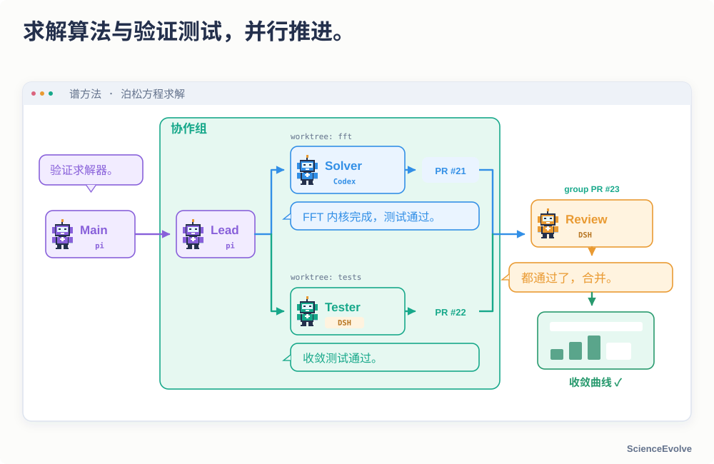
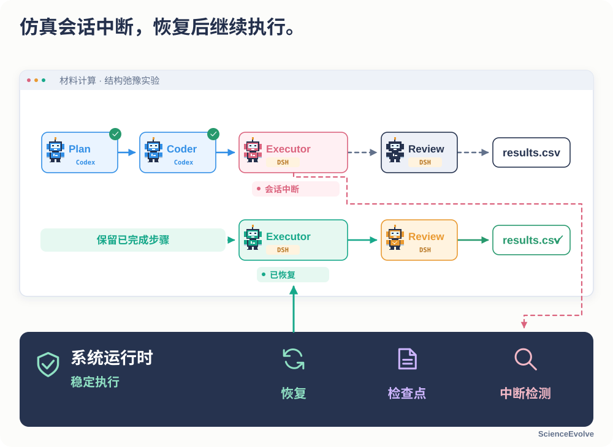
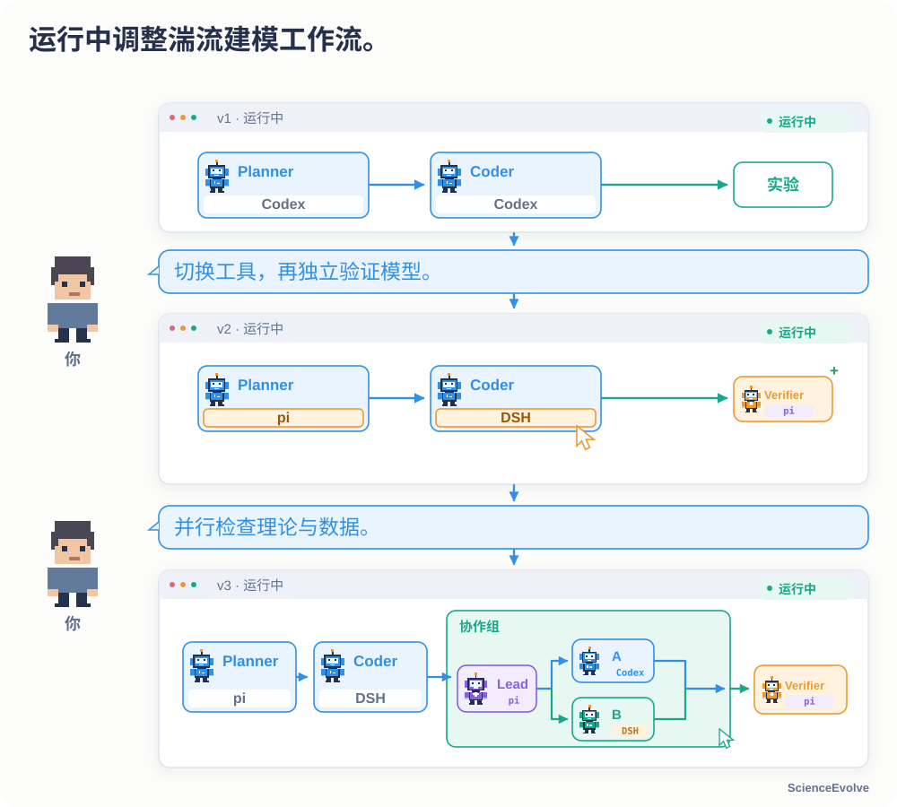

<a id="top"></a>

<h1 align="center">ScienceEvolve Server</h1>

<p align="center">
  <strong>构建、运行并持续改进自己的多 Agent 科研工作流，让工作流本身也能演化。</strong>
</p>

<p align="center">
  <a href="./README.md#top">English</a> | <strong>简体中文</strong>
</p>

<p align="center">
<a href="#sdk"></a>
<a href="#quick-start"></a>
<a href="#features"></a>
<a href="#skills-overview"></a>
<a href="#dual-loops"></a>
<a href="#tutorial"></a>
<a href="#examples"></a>
<a href="https://arxiv.org/abs/2607.03863" title="Rethinking Scientific Discovery in the Agentic Era"></a>
<a href="#configuration"></a>
</p>

<p align="center">
  <a href="docs/readme/screenshots/project-overview.png"></a>
  <a href="docs/readme/screenshots/project-execution.png"></a>
  <a href="docs/readme/screenshots/workflow-editor.png"></a>
  <br>
  <sub>项目总览 &nbsp; · &nbsp; 运行监控 &nbsp; · &nbsp; Workflow 编排</sub>
</p>

---

ScienceEvolve 是论文 [Rethinking Scientific Discovery in the Agentic Era](https://arxiv.org/abs/2607.03863) 中的自主科研框架，将研究、实验、编码和评审连接成可视化工作流。你可以组建自己的 Agent 团队，查看真实执行轨迹，让团队根据评估反馈改进任务，也可以授权 Main 调整工作流本身。

<a id="sdk"></a>

**🧩 ScienceEvolve 的两种使用方式** — 同一套工作流语义，按你的工作方式选择入口。

[](https://github.com/OpenMOSS/ScienceEvolve-server) — **Web / Server 仓库**。在网页中编排 Agent、连接模型网关、管理研究项目，查看轨迹与交付文件。

[](https://github.com/OpenMOSS/ScienceEvolve) — **SDK / CLI 仓库**。通过 TypeScript 或命令行运行工作流，将研究流程接入自己的代码与服务。参见 [SDK 示例](https://github.com/OpenMOSS/ScienceEvolve/blob/main/example/README.md)与 [Web / SDK 功能边界](docs/main-sdk-parity-zh.md)。

## 组建自己的科研 Agent 团队

> “这里有一个泊松方程求解器。请探索两种改进方案，验证收敛性，比较误差，并整理成报告。”

在画布中连接计划、并行探索、实现和评审。Main 负责协调任务与确认完成，Worker 负责研究、实验、编码和评审等具体工作；每个 Agent 可独立选择 **Codex、Claude Code、DSH 或 pi**，并配置模型、提示词、Skills 与 MCP 工具。

<div align="center">



</div>

<a id="dual-loops"></a>

## 双循环：改进任务，也改进研究流程

**任务循环**：执行任务 → 获取真实反馈 → 改进方法 → 再次执行。**流程循环**：回看研究结果 → 调整 Agent 分工、工具或连接关系 → 用更新后的工作流继续研究。你可以从固定工作流开始，按需要开启流程演化。

<div align="center">


</div>

**Evolver 就在研究团队中。** 当前实现由获得动态重配置授权的 Main 承担这一职责。Main 提交 `workflow.json` 并调用 `apply_workflow`，Server 校验后应用；研究方法是否因此变好，仍要用实际任务评估。

<div align="center">


</div>

[了解 Main / Worker 分工与双循环](docs/research-workflows_zh-CN.md#双闭环) · [查看动态重配置范围](docs/configuration_zh-CN.md#workflow)

<a id="skills-overview"></a>

## 🧠 科研 Skills

ScienceEvolve 将已发表研究中的方法提炼为**可复用的科研流程**。Agent 可以围绕当前课题明确研究问题、提出假设、设计验证、分析证据，再根据结果调整下一步，把领域方法融入自己的研究过程。

**875 个科研方法，覆盖 12 个研究领域，从 7 万余篇已发表论文中提炼。**

- **🧭 研究设计**：明确适用场景与所需输入，组织可检验的假设、变量、对照和研究步骤，约定预期产出。
- **🔎 证据与验证**：设置验证条件和结论边界，区分已验证事实、推断与待检验假设，让结论与证据对应。
- **🔄 反馈与迭代**：识别失败模式；当证据不足、观测与假设矛盾时，给出复验、修订研究方案或转向的判断条件。

为团队中不同 Agent 选择与课题相关的 Skill，并提供研究目标、已有证据和可用资源，即可将这些方法用于研究规划与结果分析。**复用的是研究方法，具体结论仍需由当前课题的证据和验证支持。**

<p>
<a href=".agents/skills/scientific/immune-recognition/README_zh-CN.md#top"></a>
<a href=".agents/skills/scientific/aqueous-batteries/README_zh-CN.md#top"></a>
<a href=".agents/skills/scientific/asymmetric-catalysis/README_zh-CN.md#top"></a>
<br>
<a href=".agents/skills/scientific/chromatin-regulation/README_zh-CN.md#top"></a>
<a href=".agents/skills/scientific/quantum-materials/README_zh-CN.md#top"></a>
<a href=".agents/skills/scientific/fiber-composites/README_zh-CN.md#top"></a>
<br>
<a href=".agents/skills/scientific/cosmology/README_zh-CN.md#top"></a>
<a href=".agents/skills/scientific/fusion/README_zh-CN.md#top"></a>
<a href=".agents/skills/scientific/neuromorphic-computing/README_zh-CN.md#top"></a>
<br>
<a href=".agents/skills/scientific/organometallic-catalysis/README_zh-CN.md#top"></a>
<a href=".agents/skills/scientific/polymer-composites/README_zh-CN.md#top"></a>
<a href=".agents/skills/scientific/urban-resilience/README_zh-CN.md#top"></a>
</p>

<sub>点击分类浏览技能 &nbsp; · &nbsp; <a href="#scientific-skills">技能使用与示例</a> &nbsp; · &nbsp; <a href=".agents/skills/README_zh-CN.md#top">全部 Skills</a></sub>

<a id="features"></a>

## 核心功能

### 让 Main 调整工作流

获得授权后，Main 可以增删 Agent、调整职责和路径、切换 Harness，并提交新的工作流。Server 校验通过后再应用；团队可根据当前任务重新分工。[查看配置范围](docs/configuration_zh-CN.md#workflow)。

<div align="center">



</div>

### 设置 Loop 轮次与退出 Agent

Main 发起有限元网格收敛实验，Coder → Executor → Review 整组运行 3 轮后，退出到用户指定的 Writer，由其交付误差评估报告（errors.md）。轮数与退出 Agent 均可配置。

<div align="center">



</div>

### 根据实验结果回滚重试

Idea 将增大仿真时间步长的方案交给 Execution。候选变更集成后评分下降，接手的 Review 直接用 Git 撤销该变更，恢复已接受的代码并复验；撤销形成新提交，原提交与失败实验保留。

<div align="center">



</div>

### 并行修改，评审后集成

启用 Git 协作后，Agent 在独立 worktree 中完成修改，使用协作组组织并行探索，再通过评审与逐级 Pull Request 集成结果。[配置 GitHub 账号](docs/configuration_zh-CN.md#github-账号库与-git-协作)。

<div align="center">



</div>

### 从中断处继续执行

System Runtime 保存项目状态、已完成进度和执行轨迹。可恢复的中断经恢复后继续推进评审与交付；涉及外部作业时，先核对实际进程与结果。

<div align="center">



</div>

### 用自然语言持续调整

通过 **Project Explainer** 解释当前流程、编辑 Agent 配置、添加循环与协作组。运行中修改经过[工作流更新机制](docs/configuration_zh-CN.md#推荐配置与-project-explainer)应用，并保留服务端接受的版本。

<div align="center">



</div>

<a id="scientific-skills"></a>

## Skills 使用与示例

**875 个领域科研方法技能，覆盖 12 个领域；另提供 24 个研究与写作辅助技能。**

<a id="scientific-methods"></a>

### 领域科研方法 · 12 个领域 / 875 个技能

覆盖假设生成、研究设计、实验验证、证据分析与迭代。可通过上面的分类卡片浏览各领域的方法。

每个 Skill 包含适用场景、所需输入、研究步骤、预期输出、验证条件、结论边界与失败处理。目录层级用于浏览，已有 `builtin:<name>` 引用保持不变。

<details>
<summary><strong>展开查看一个 Skill：不对称催化研究设计</strong></summary>

[手性催化剂研究设计 Skill](.agents/skills/scientific/asymmetric-catalysis/sci-catalysis-asymmetric-catalysis-chiral-catalyst-rese-1571cd89/SKILL.md) 引导 Agent 完成：

> 定义研究问题 → 提出竞争假设 → 设计最小验证 → 分析证据 → 迭代或调整方向。

它要求提供目标转化、已有证据、候选机制与可用分析手段，并在各阶段设置判断条件：证据无法区分假设时，重新设计验证；观测与机制不符时，修正假设。输出包括研究计划、对照、判定标准及有证据支持的结论边界。

</details>

**网页端使用：** 在工作流中选中 Agent，通过现有 Skills 入口添加相关技能，按需要选择固定加载或由支持该能力的 Harness 自动选择。技能随项目提供，无需另行下载。

Main 获得工作流动态调整权限后，也可以随研究进展调整 Skill 配置。具体数据、工具与实际实验环境仍按课题配置。

[浏览全部研究领域](.agents/skills/scientific/README_zh-CN.md#top)

<a id="general-skills"></a>

### 研究与写作辅助技能 · 24

覆盖研究统筹、构思、文献调研、实验设计、论文写作、绘图与评审，并提供 Inspire 实验操作说明。

- **团队角色 · 5**：研究统筹、构思、实验执行、写作与评审。
- **科研、写作与评审 · 15**：CCFA、Nature 风格与综合写作方法。
- **实验操作 · 1**：Inspire 操作与实验资源说明。
- **Agent4Sci · 3**：文献驱动研究、实验执行与策略检查。完整流程同时选择三个固定技能；checklist 按需调用。[配置与示例](docs/agent4sci.md)。

[浏览研究与写作技能](.agents/skills/general/README_zh-CN.md#top)

<a id="quick-start"></a>

## 快速开始

准备 **Node.js 24+**、**npm 10+**、已安装的 [Inspire CLI](.agents/skills/general/inspire/references/setup/install-and-config.md#1-安装)，以及一个可用的模型网关。当前 Server 启动时会检查 Inspire，本地任务也需要能找到该 CLI。

### 1. 安装并启动

从仓库页面的 **Code → HTTPS** 复制克隆地址，替换下面的 `REPOSITORY_URL`：

```bash
git clone REPOSITORY_URL ScienceEvolve
cd ScienceEvolve
npm ci
npm ci --prefix harness/codex
cp .env.example .env
```

使用默认 `./data` 时，将 `.env` 中的 `SCIENCEEVOLVE_INSPIRE_WORKSPACE_ROOT` 改为仓库的绝对路径。Inspire 不在 `PATH` 中时，设置 `SCIENCEEVOLVE_INSPIRE_BIN` 为可执行文件的绝对路径。更新已有安装时保留原来的 `.env`。

```bash
npm run dev
```

打开工作台 **<http://127.0.0.1:5173>**；[API 健康检查](http://127.0.0.1:4311/api/health)应返回包含 `"status":"ok"` 的 JSON。其他 Harness、环境变量和部署方式见[安装与配置指南](docs/configuration_zh-CN.md#快速开始)。

### 2. 连接模型

打开 **“全局网关库”**，填写模型服务的 HTTPS 地址和 API key，选择协议与可用模型，保存并设为默认网关。点击 **“测试连接”**，在 Harness/model 矩阵中验证将要使用的组合。每个 Agent 的模型和思考选项都应与该网关实际支持的选项一致。

### 3. 手动导入一个 Workflow

仓库的 [example/](example/README.md) 保留 Workflow JSON、需求与参考资源，应用不自动加载这些流程。先在运行 Server 的机器上手动导出一个网页导入副本：

```bash
node example/export-web-workflow.mjs \
  example/02-software-development/workflow.json /tmp/software.web.json
```

在主页点击 **“导入 SDK workflow.json”**，选择生成的文件并预览；关闭预览后，在 **“快速发起研究任务 → Agent 配置预设”** 中选择导入项。粘贴[软件任务需求](example/02-software-development/requirement.txt)，为每个 Agent 配置可用的 Harness、网关与模型，保持并行协作关闭，点击 **“提交并继续”**。

项目完成后检查最终代码、使用说明及 `development/final.md` 中的实际测试记录。完整手动导入步骤见下面的折叠教程；SDK 运行方式见 [SDK 使用指南](https://github.com/OpenMOSS/ScienceEvolve/blob/main/sdk/README_zh-CN.md)。

<a id="tutorial"></a>

## 网页实操：从第一个任务到自定义编排

通过通用 JSON 导入、Workflow 画布、Agent 属性面板与 Project Explainer，将自己的需求配置为可执行流程。先跑通一个小任务，再按需要加入 Loop、并行协作与流程演化。

<details>
<summary><strong>① 跑通一个真实项目：构建并测试 Node.js Todo CLI</strong></summary>

### 手动导入流程，准备需求

1. 按上面的命令，将[原始 Workflow](example/02-software-development/workflow.json)导出为单独的 `software.web.json`。脚本补齐网页格式、移除顶层部署字段，并解析 Skill 路径；原文件不变，需求仍单独保存。输出文件已存在时换一个文件名。
2. 在主页点击 **“导入 SDK workflow.json”**，选择导出的文件。导入后打开原文只读画布；检查 coding、testing 与 Main 的职责，然后关闭预览。
3. 在 **“快速发起研究任务 → Agent 配置预设”** 下拉框中选择刚导入的流程，载入可编辑副本。将 [requirement.txt](example/02-software-development/requirement.txt) 的内容复制到 **“研究任务需求”**，保留 `add / list / done / remove`、JSON 持久化、损坏文件保护和错误退出码等验收要求。
4. 如果要上传已有代码，先在快速发起中 **“保存 → 另存为新配置”**，然后进入 **“新建项目”** 选择该配置，通过 **“补充文件与图片” → “选择文件或图片 / 选择文件夹”** 上传。输入文件保存在项目的 `user_inputs/`；新建页使用 **“创建并启动研究”** 启动。

### 在画布中检查路径与模型

下图是通过通用导入入口打开的实际只读画布，尚未连接模型或启动研究。关闭预览并在快速发起中选择导入项后，点击 **“打开 Workflow 画布编辑器”** 编辑副本。

<div align="center">


</div>

```text
用户输入 → coding → testing → 通过：完成
             ↑        │
             └─ 失败 ─┘
Main：协调异常恢复与用户补充输入
```

- 点击 coding 或 testing，在 **“Agent 属性面板”** 中检查 **Harness、全局网关、model、网关思考强度**。Main 也需要有效配置；模板中的模型名称不会自动变成你有权使用的模型。
- coding → testing 是强边；testing 根据真实测试结果选择修复或完成。testing 是本例指定的终止 Agent，并显式允许自动完成。画出通往结束的线，并不会直接判定任务成功。
- 本例使用条件重试，**没有固定轮数的 Loop**。暂时保持并行协作和 Main 自动调整 Workflow 关闭。按 **“保存流程”** 返回，并按需另存配置；导入原文保持只读。
- **“推荐配置”** 是可选的辅助工具。载入指定方法后，如果使用推荐或 Project Explainer 修改流程，应再次检查角色、路径和验收条件。

### 启动、跟踪并检查产物

在主页点击 **“提交并继续”**，在项目页查看 coding 的实现、testing 的独立测试及失败交接。如果改从新建页启动，则点击 **“创建并启动研究”**；**“保存课题”** 只保存草稿。

预期交付是可运行的 `cli.mjs`、Node 内置测试用例、使用说明，以及 `development/` 中的各轮测试证据和 `final.md`。测试应使用临时目录与 `TODO_DATA_FILE`，覆盖持久化、空输入、重复 done、未知 ID、损坏 JSON 和非法参数。只有当前版本的必测用例真实通过，才能结束；请以本次运行的实际文件和命令记录验收。

遇到可恢复的中断，先查看项目状态、失败原因与已有轨迹，再使用 **“暂停项目” / “启动项目”**；中断项目会提供 **“启动并恢复”**。恢复保留已完成进度，但外部实验或工具进程需要核对真实状态后再继续。

[查看软件例子的完整协议](example/02-software-development/README.md) · [工作区与成果说明](docs/configuration_zh-CN.md#workspace-与成果完整性)

</details>

<details>
<summary><strong>② 编排自己的 Workflow：Agent、强弱边、Loop、协作组与运行中调整</strong></summary>

### 添加 Agent，配置它能做的事

在 **“Agent 模板”** 中选择模板并添加副本，点击节点编辑职责、Agent 指令、Harness、模型、Skills 和 MCP。Main 是唯一且必需的协调 Agent，不能删除或重命名；新增 Worker 后需要自行连接业务路径。Main 的固定调度边由系统维护。

模型网关、已安装 Harness、Skills 文件和 MCP 服务都必须实际可用。任务文件通过网页上传；需要 GPU、实验平台或湿实验的流程，先按对应例子的前提准备外部资源。

### 连接路径，明确谁来判断完成

从节点端口拖出连线，或在属性面板中选择 **“连接目标” → “添加连接”**：

<table>
<thead>
<tr><th align="left">编排项</th><th align="left">应如何使用</th></tr>
</thead>
<tbody><tr><td align="left">强边</td><td align="left">当前 Agent 完成后直接进入唯一目标；不能同时混入其他出边候选。</td></tr>
<tr><td align="left">弱边</td><td align="left">提供多个候选去向，由配置的 Main 或当前 Worker 决策；失败回修、分支选择适合这种路径。</td></tr>
<tr><td align="left">终止节点</td><td align="left">默认由 Main 验收；非 Main 终止 Agent 只有显式获准自动完成且处于合法上下文时，才能提交完成。验收条件应写清实际证据。</td></tr>
</tbody></table>

### 用 AHE 理解 Loop 批次

按相同的手动导出与导入步骤，载入 [AHE · 代码自进化](example/01-ahe-evolve/workflow.json)，可看到 `optimizer → execute → judge → optimizer` 的强边闭环。合法闭环会建立 Loop，无需另加一个 Loop 节点。点击任意成员边，在右侧设置 Loop ID、每批迭代数和退出目标。

本例的配置为：

```json
{
  "id": "code_evolution",
  "from": "judge",
  "to": "optimizer",
  "maxIterations": 3,
  "exitTo": "main"
}
```

这表示**一批最多 3 轮，批次结束交给 Main**。Main 按原目标判断交付，或回到 optimizer 开始下一批；它不是整个项目只运行 3 轮。`from → exitTo` 的虚线是只读批次出口，不会每轮都执行。暂停、恢复和失败重试保留 batch、iteration、total 计数；打断闭环会移除对应 Loop。

### 需要并行开发时，再开启 Git 协作

先配置 **“GitHub 账号”**，再启用 **“并行协作模式”** 并新建协作组。选择已有 Agent 作为 Leader，引用其他 Agent 作为组内业务节点；点击组进入内部 Workflow，使用面包屑或 **“返回父图”** 返回。只有组入口发出的边会创建并行路径，组内仍可使用强弱边、Loop 和嵌套协作组。

同一 Agent 在多个位置引用时共享配置、会话和目录，调用按队列串行；不同 Agent 可并行执行。“结束协作组”需要等待必要路径与 Git 集成，逐级 PR 合并及本地同步完成后才推进后续节点。具体配置见 [Git 账号与协作](docs/configuration_zh-CN.md#github-账号库与-git-协作)和[协作组内 Workflow](docs/openfars-collaboration/scoped-workflow-v3.md)。

### 保存、调整与恢复

使用 **“智能整理 / 分层重排 / 适应画布”** 检查全图。保存时可选择 **“更新当前配置 / 仅本次项目使用 / 另存为新配置”**；导入原文只读，修改另存为自己的配置。

**Project Explainer** 可辅助编辑草稿、解释流程并提交允许范围内的运行中调整。若希望 Main 自主改变编排，创建前开启 **“允许 Main 动态重配置（高级权限）”**；Main 只能在获授权的轮次提交 `workflow.json`，并通过 `apply_workflow` 校验应用。凭据、运行权限、会话与思考策略、授权开关等仍锁定；已接受的 Skill/MCP 内容不可同名覆盖，修改内容需新增定义并更新引用。

运行中以服务端已接受的配置和实际轨迹为准；暂停、提交调整和恢复是不同动作。完整可编辑范围见 [Workflow 配置](docs/configuration_zh-CN.md#workflow)，助手使用方式见 [Project Explainer](docs/configuration_zh-CN.md#推荐配置与-project-explainer)。

</details>

<a id="examples"></a>

## 论文与开源工作流示例

我们参考公开论文与开源项目，将其中的 Agent 分工、任务路径与反馈循环编排为 ScienceEvolve Workflow。感谢原作者开放方法和代码；下面的表格同时提供**原始来源、官方项目与我们的实现**。

本页展示 **21 个工作流示例，其中 3 个适合入门**，对应文件见 [example/](example/README.md)。它们以 JSON 配置、参考资源与说明文档的形式提供；Web 端由用户自行复制、导出和导入，不设置专门的模板展示区，也不自动加载或随 Server 打包。

### 先从三个入门流程开始

[软件开发与测试](example/02-software-development/README.md) — 编码、独立测试、失败回修。 · [AHE · 代码自进化](example/01-ahe-evolve/README.md) — 执行、评分、优化与批间裁决。 · [默认科研工作流](example/dynamic-research-workflow/README.md) — 构思、执行、写作、评审与 Main 协调。

### 论文与开源项目工作流

<table>
<thead>
<tr><th align="left">方法</th><th align="left">原始论文</th><th align="left">官方代码 / 项目</th><th align="left">本项目 Workflow</th></tr>
</thead>
<tbody><tr><td align="left"><a href="example/01-ahe-evolve/README.md">AHE · 代码自进化</a></td><td align="left"><a href="https://arxiv.org/abs/2604.25850" title="Agentic Harness Engineering: Observability-Driven Automatic Evolution of Coding-Agent Harnesses">arXiv:2604.25850</a></td><td align="left"><a href="https://github.com/china-qijizhifeng/agentic-harness-engineering">agentic-harness-engineering</a></td><td align="left"><a href="example/01-ahe-evolve/workflow.json">JSON</a> · <a href="docs/readme/workflows/01-ahe-evolve.jpg">画布</a></td></tr>
<tr><td align="left"><a href="example/aris/README.md">ARIS</a></td><td align="left"><a href="https://arxiv.org/abs/2605.03042" title="ARIS: Autonomous Research via Adversarial Multi-Agent Collaboration">arXiv:2605.03042</a></td><td align="left"><a href="https://github.com/wanshuiyin/Auto-claude-code-research-in-sleep" title="wanshuiyin/Auto-claude-code-research-in-sleep">ARIS</a></td><td align="left"><a href="example/aris/workflow.json">JSON</a> · <a href="docs/readme/workflows/aris.jpg">画布</a></td></tr>
<tr><td align="left"><a href="example/metaharness/README.md">Meta-Harness</a></td><td align="left"><a href="https://arxiv.org/abs/2603.28052" title="Meta-Harness: End-to-End Optimization of Model Harnesses">arXiv:2603.28052</a></td><td align="left"><a href="https://github.com/stanford-iris-lab/meta-harness">meta-harness</a></td><td align="left"><a href="example/metaharness/workflow.json">JSON</a> · <a href="docs/readme/workflows/metaharness.jpg">画布</a></td></tr>
<tr><td align="left"><a href="example/autoresearch/README.md">autoresearch</a></td><td align="left">—（以项目为来源）</td><td align="left"><a href="https://github.com/karpathy/autoresearch">autoresearch</a></td><td align="left"><a href="example/autoresearch/workflow.json">JSON</a> · <a href="docs/readme/workflows/autoresearch.jpg">画布</a></td></tr>
<tr><td align="left"><a href="example/funsearch/README.md">FunSearch</a></td><td align="left"><a href="https://www.nature.com/articles/s41586-023-06924-6" title="Mathematical discoveries from program search with large language models">Nature 2023</a></td><td align="left"><a href="https://github.com/google-deepmind/funsearch">funsearch</a></td><td align="left"><a href="example/funsearch/workflow.json">JSON</a> · <a href="docs/readme/workflows/funsearch.jpg">画布</a></td></tr>
<tr><td align="left"><a href="example/agent-laboratory/README.md">Agent Laboratory</a></td><td align="left"><a href="https://arxiv.org/abs/2501.04227" title="Agent Laboratory: Using LLM Agents as Research Assistants">arXiv:2501.04227</a></td><td align="left"><a href="https://github.com/SamuelSchmidgall/AgentLaboratory">AgentLaboratory</a></td><td align="left"><a href="example/agent-laboratory/workflow.json">JSON</a> · <a href="docs/readme/workflows/agent-laboratory.jpg">画布</a></td></tr>
<tr><td align="left"><a href="example/sciagents/README.md">SciAgents</a></td><td align="left"><a href="https://arxiv.org/abs/2409.05556" title="SciAgents: Automating scientific discovery through multi-agent intelligent graph reasoning">arXiv:2409.05556</a></td><td align="left"><a href="https://github.com/lamm-mit/SciAgentsDiscovery">SciAgentsDiscovery</a></td><td align="left"><a href="example/sciagents/workflow.json">JSON</a> · <a href="docs/readme/workflows/sciagents.jpg">画布</a></td></tr>
<tr><td align="left"><a href="example/robin/README.md">Robin</a></td><td align="left"><a href="https://arxiv.org/abs/2505.13400v1" title="Robin: A multi-agent system for automating scientific discovery">arXiv:2505.13400</a></td><td align="left"><a href="https://github.com/Future-House/robin">robin</a></td><td align="left"><a href="example/robin/workflow.json">JSON</a> · <a href="docs/readme/workflows/robin.jpg">画布</a></td></tr>
<tr><td align="left"><a href="example/co-scientist/README.md">Google AI co-scientist</a></td><td align="left"><a href="https://arxiv.org/abs/2502.18864v1" title="Towards an AI co-scientist">arXiv:2502.18864</a></td><td align="left">— †</td><td align="left"><a href="example/co-scientist/workflow.json">JSON</a> · <a href="docs/readme/workflows/co-scientist.jpg">画布</a></td></tr>
<tr><td align="left"><a href="example/biomni/README.md">Biomni A1 / E1</a></td><td align="left"><a href="https://www.biorxiv.org/content/10.1101/2025.05.30.656746v1" title="Biomni: A General-Purpose Biomedical AI Agent">bioRxiv 2025</a></td><td align="left"><a href="https://github.com/snap-stanford/Biomni">Biomni</a></td><td align="left"><a href="example/biomni/workflow.json">JSON</a> · <a href="docs/readme/workflows/biomni.jpg">画布</a></td></tr>
<tr><td align="left"><a href="example/agentrxiv/README.md">AgentRxiv</a></td><td align="left"><a href="https://arxiv.org/abs/2503.18102" title="AgentRxiv: Towards Collaborative Autonomous Research">arXiv:2503.18102</a></td><td align="left"><a href="https://github.com/SamuelSchmidgall/AgentLaboratory">AgentLaboratory</a></td><td align="left"><a href="example/agentrxiv/workflow.json">JSON</a> · <a href="docs/readme/workflows/agentrxiv.jpg">画布</a></td></tr>
<tr><td align="left"><a href="example/rrsi/README.md">RRSI</a></td><td align="left"><a href="https://arxiv.org/abs/2609.24972" title="RRSI: Regularized Recursive Self-Improvement of Agent Harnesses">arXiv:2609.24972</a></td><td align="left"><a href="https://github.com/google-research/rrsi">rrsi</a></td><td align="left"><a href="example/rrsi/workflow.json">JSON</a> · <a href="docs/readme/workflows/rrsi.jpg">画布</a></td></tr>
<tr><td align="left"><a href="example/drugevolve/README.md">DrugEvolve</a></td><td align="left"><a href="https://www.biorxiv.org/content/10.64898/2026.08.16.745117v1" title="An AI System for Autonomous Algorithm Evolution in Drug Development">bioRxiv 2026</a></td><td align="left"><a href="https://github.com/GAIR-NLP/DrugEvolve">DrugEvolve</a></td><td align="left"><a href="example/drugevolve/workflow.json">JSON</a> · <a href="docs/readme/workflows/drugevolve.jpg">画布</a></td></tr>
<tr><td align="left"><a href="example/scientist-two/README.md">ScientistTwo</a></td><td align="left"><a href="https://arxiv.org/abs/2609.19644v1" title="ScientistTwo: Pioneering the Human Knowledge Frontier with Autonomous AI">arXiv:2609.19644</a></td><td align="left">— †</td><td align="left"><a href="example/scientist-two/workflow.json">JSON</a> · <a href="docs/readme/workflows/scientist-two.jpg">画布</a></td></tr>
<tr><td align="left"><a href="example/ai-scientist-v2/README.md">AI Scientist v2</a></td><td align="left"><a href="https://arxiv.org/abs/2504.08066" title="The AI Scientist-v2: Workshop-Level Automated Scientific Discovery via Agentic Tree Search">arXiv:2504.08066</a></td><td align="left"><a href="https://github.com/SakanaAI/AI-Scientist-v2">AI-Scientist-v2</a></td><td align="left"><a href="example/ai-scientist-v2/workflow.json">JSON</a> · <a href="docs/readme/workflows/ai-scientist-v2.jpg">画布</a></td></tr>
<tr><td align="left"><a href="example/internagent-1-5/README.md">InternAgent 1.5</a></td><td align="left"><a href="https://arxiv.org/abs/2602.08990" title="InternAgent-1.5: A Unified Agentic Framework for Long-Horizon Autonomous Scientific Discovery">arXiv:2602.08990</a></td><td align="left"><a href="https://github.com/InternScience/InternAgent">InternAgent</a></td><td align="left"><a href="example/internagent-1-5/workflow.json">JSON</a> · <a href="docs/readme/workflows/internagent-1-5.jpg">画布</a></td></tr>
<tr><td align="left"><a href="example/biomni-r0/README.md">Biomni-R0</a></td><td align="left"><a href="https://biomni.stanford.edu/blog/biomni-r0-technical-report" title="Biomni-R0 technical report">技术报告</a></td><td align="left"><a href="https://github.com/snap-stanford/Biomni">Biomni</a></td><td align="left"><a href="example/biomni-r0/workflow.json">JSON</a> · <a href="docs/readme/workflows/biomni-r0.jpg">画布</a></td></tr>
<tr><td align="left"><a href="example/chemical-coscientist/README.md">化学 Coscientist</a></td><td align="left"><a href="https://www.nature.com/articles/s41586-023-06792-0" title="Autonomous chemical research with large language models">Nature 2023</a></td><td align="left"><a href="https://github.com/gomesgroup/coscientist">coscientist</a></td><td align="left"><a href="example/chemical-coscientist/workflow.json">JSON</a> · <a href="docs/readme/workflows/chemical-coscientist.jpg">画布</a></td></tr>
<tr><td align="left"><a href="example/raven/README.md">Raven Host</a></td><td align="left"><a href="https://arxiv.org/abs/2609.33439" title="Raven: The Harness of Harnesses for Composable Agentic Intelligence">arXiv:2609.33439</a></td><td align="left"><a href="https://github.com/EverMind-AI/Raven">Raven</a></td><td align="left"><a href="example/raven/workflow.json">JSON</a> · <a href="docs/readme/workflows/raven.jpg">画布</a></td></tr>
</tbody></table>

† Google AI co-scientist 与 ScientistTwo 按公开论文及可用组件独立实现；固定来源未提供完整官方系统源码。autoresearch 的固定来源为官方项目；AgentRxiv 的代码包含在 Agent Laboratory 仓库中。各例说明列出具体来源版本、适配范围与工具条件。

**本表收录的是 workflow 结构与编排的实现或适配**，不以论文实验或指标的复现作为收录条件。各例说明提供方法映射与工具要求，详见[来源与适配范围](docs/research-workflows_zh-CN.md#科研论文与方法示例)。

<details>
<summary><strong>查看真实 Workflow 画布：软件开发与测试 / AHE 代码自进化</strong></summary>

以下是通过现有通用 JSON 导入入口打开的实际前端截图，仅展示配置，未连接模型或运行研究。

**软件开发与测试** — coding 实现，testing 独立验收，失败回修。

<div align="center">


</div>

**AHE 代码自进化** — 执行、评分、优化闭环，每批 3 轮后返回 Main 判断。

<div align="center">


</div>

[查看 21 张 Workflow 画布截图](docs/readme/workflows/README.md) · [手动导入说明](example/README.md#在-web-中手动查看和使用)

</details>

[查看完整 example 目录](example/README.md) · [了解来源、协议与验证范围](docs/research-workflows_zh-CN.md#科研论文与方法示例)

## 内置 Skill 来源与致谢

前端与服务端共用 [`.agents/skills`](.agents/skills) 中的内置技能。对应上游开源仓库及使用关系如下。

<table>
<thead>
<tr><th align="left">内置 Skill / 资源</th><th align="left">上游开源仓库</th><th align="left">在 ScienceEvolve 中的使用</th></tr>
</thead>
<tbody><tr><td align="left"><code>ccf-common</code>、<code>ccf-experiment-designer</code>、<code>ccf-idea-optimizer</code>、<code>ccf-idea-reviewer</code>、<code>ccf-literature-monitor</code>、<code>ccf-literature-searcher</code>、<code>ccf-paper-reviewer</code>、<code>ccf-paper-to-exemplar</code>、<code>ccf-paper-writer</code>、<code>ccf-visual-composer</code></td><td align="left"><a href="https://github.com/mikubaka88/CCFA-Skills">mikubaka88/CCFA-Skills</a></td><td align="left">适配科研、写作、评审与可视化技能。</td></tr>
<tr><td align="left"><code>nature-figure</code>、<code>nature-polishing</code>、<code>nature-shared</code>、<code>nature-writing</code></td><td align="left"><a href="https://github.com/Yuan1z0825/nature-skills">Yuan1z0825/nature-skills</a></td><td align="left">集成 Nature 风格写作、润色、绘图及共享参考资料。</td></tr>
<tr><td align="left"><code>awesome-ai-research-writing-director</code></td><td align="left"><a href="https://github.com/Leey21/awesome-ai-research-writing">Leey21/awesome-ai-research-writing</a></td><td align="left">综合写作方法，并适配论文正文输出合同。</td></tr>
<tr><td align="left"><code>inspire</code></td><td align="left"><a href="https://github.com/realZillionX/InspireSkill">realZillionX/InspireSkill</a></td><td align="left">集成启智平台操作知识，并适配 SII MCP。</td></tr>
<tr><td align="left"><code>nature-figure</code> 使用的绘图参考</td><td align="left"><a href="https://github.com/ChenLiu-1996/figures4papers">ChenLiu-1996/figures4papers</a></td><td align="left">科研图设计与绘图方法参考。</td></tr>
</tbody></table>

内置版本包含 ScienceEvolve 的集成调整。项目角色技能 `research-director`、`idea-agent`、`experiment-runner`、`latex-writer` 和 `iclr-reviewer` 随本仓库维护。感谢上游作者与贡献者。

CCFA 与 Nature 的内置副本未记录导入时的提交版本；上游仓库归属通过比对 Skill 名称与内容确认。

<a id="configuration"></a>

## 按需深入配置

<table>
<thead>
<tr><th align="left">你要完成的事</th><th align="left">对应指南</th></tr>
</thead>
<tbody><tr><td align="left">安装、修改端口和数据目录、部署服务</td><td align="left"><a href="docs/configuration_zh-CN.md#%E5%BF%AB%E9%80%9F%E5%BC%80%E5%A7%8B">安装与环境</a> · <a href="docs/configuration_zh-CN.md#%E6%9C%8D%E5%8A%A1%E7%8E%AF%E5%A2%83">服务环境</a> · <a href="docs/configuration_zh-CN.md#%E7%94%9F%E4%BA%A7%E8%BF%90%E8%A1%8C">生产运行</a></td></tr>
<tr><td align="left">接入模型服务、选择协议和验证组合</td><td align="left"><a href="docs/configuration_zh-CN.md#%E5%85%A8%E5%B1%80%E7%BD%91%E5%85%B3">全局网关</a></td></tr>
<tr><td align="left">安装其他 Harness、调整单个 Agent</td><td align="left"><a href="docs/configuration_zh-CN.md#harness">Harness</a> · <a href="docs/configuration_zh-CN.md#agent">Agent 参数</a> · <a href="harness/README.md">运行时说明</a></td></tr>
<tr><td align="left">连接工具、添加项目级资源</td><td align="left"><a href="docs/configuration_zh-CN.md#skills-%E4%B8%8E-mcp">Skills 与 MCP</a> · <a href="docs/inspire-async-experiments.md">Inspire / SII 实验</a></td></tr>
<tr><td align="left">设置 GitHub OAuth、并行与嵌套协作</td><td align="left"><a href="docs/configuration_zh-CN.md#github-%E8%B4%A6%E5%8F%B7%E5%BA%93%E4%B8%8E-git-%E5%8D%8F%E4%BD%9C">Git 账号配置</a> · <a href="docs/openfars-collaboration/scoped-workflow-v3.md">协作组内 Workflow</a></td></tr>
<tr><td align="left">查看编排、权限、恢复与宿主差异</td><td align="left"><a href="docs/configuration_zh-CN.md#workflow">Workflow</a> · <a href="docs/architecture.md">系统架构</a> · <a href="docs/main-sdk-parity-zh.md">Web / SDK 边界</a></td></tr>
</tbody></table>

<a id="resources"></a>

## 补充文档链接

<table>
<thead>
<tr><th align="left">文档</th><th align="left">链接</th></tr>
</thead>
<tbody>
<tr><td align="left">研究工作流说明</td><td align="left"><a href="docs/research-workflows_zh-CN.md">Main / Worker 分工、双循环与方法来源</a></td></tr>
<tr><td align="left">SDK 文档</td><td align="left"><a href="https://github.com/OpenMOSS/ScienceEvolve/blob/main/sdk/README_zh-CN.md">SDK 使用指南</a> · <a href="https://github.com/OpenMOSS/ScienceEvolve/blob/main/example/README.md">SDK 示例</a></td></tr>
<tr><td align="left">Workflow 文件与手动导入</td><td align="left"><a href="example/README.md">示例目录与导入说明</a></td></tr>
<tr><td align="left">Workflow 画布截图</td><td align="left"><a href="docs/readme/workflows/README.md">21 张真实 Workflow 画布</a></td></tr>
<tr><td align="left">Inspire CLI 安装</td><td align="left"><a href=".agents/skills/general/inspire/references/setup/install-and-config.md">安装与配置说明</a></td></tr>
</tbody>
</table>
