# Actual Workflow canvases

[← Back to README](../../../README.md#examples) · **English** | [简体中文](README.md) · [Manual import](../../../example/README_en.md#manual-use-in-web)

These screenshots show the actual frontend canvas for all 21 repository examples, opened through the existing generic JSON importer after exporting copies with the optional script. They display configuration only; no models were connected and no research tasks ran. Large graphs appear smaller in overview. Import the JSON to zoom in on individual nodes.

## Default research workflow

Ideation, execution, writing, and review coordinated by Main.

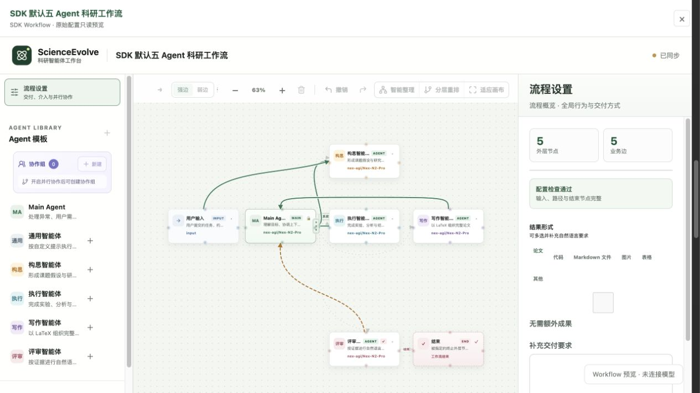

[Original Workflow JSON](../../../example/dynamic-research-workflow/workflow.json) · [Requirements](../../../example/dynamic-research-workflow/requirement.txt) · [Implementation notes and resources](../../../example/dynamic-research-workflow/README.md)

## AHE · Code evolution

Execution, scoring, and refinement Loops; Main decides whether to continue or deliver after each batch.

[Original Workflow JSON](../../../example/01-ahe-evolve/workflow.json) · [Requirements](../../../example/01-ahe-evolve/requirement.txt) · [Implementation notes and resources](../../../example/01-ahe-evolve/README.md)

## Software development and testing

Coding receives requirements; Testing independently checks the result and returns failures for repair.

[Original Workflow JSON](../../../example/02-software-development/workflow.json) · [Requirements](../../../example/02-software-development/requirement.txt) · [Implementation notes and resources](../../../example/02-software-development/README.md)

## ARIS

W1 → W1.5 → W2 → writing and cross-model review.

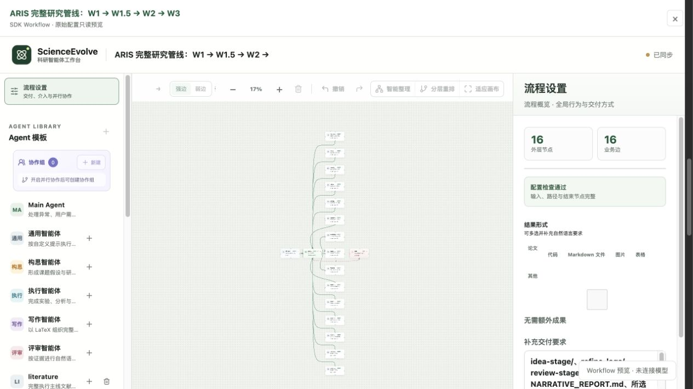

[Original Workflow JSON](../../../example/aris/workflow.json) · [Requirements](../../../example/aris/requirement.txt) · [Implementation notes and resources](../../../example/aris/README.md)

## Meta-Harness

Baseline, candidate Harnesses, full-dataset evaluation, and Pareto selection.

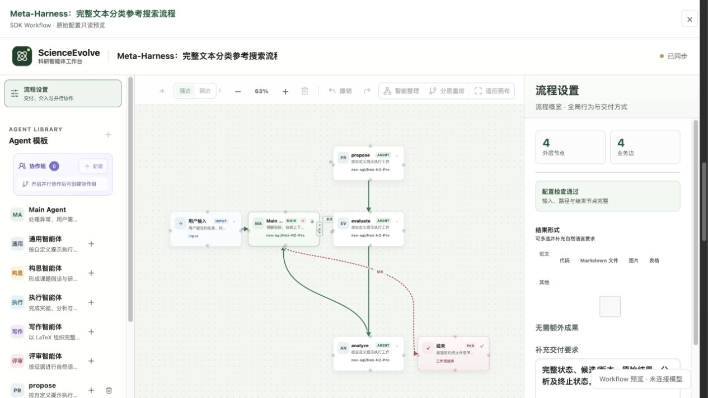

[Original Workflow JSON](../../../example/metaharness/workflow.json) · [Requirements](../../../example/metaharness/requirement.txt) · [Implementation notes and resources](../../../example/metaharness/README.md)

## autoresearch

Fixed-budget training experiments; keep, discard, or revert based on actual results.

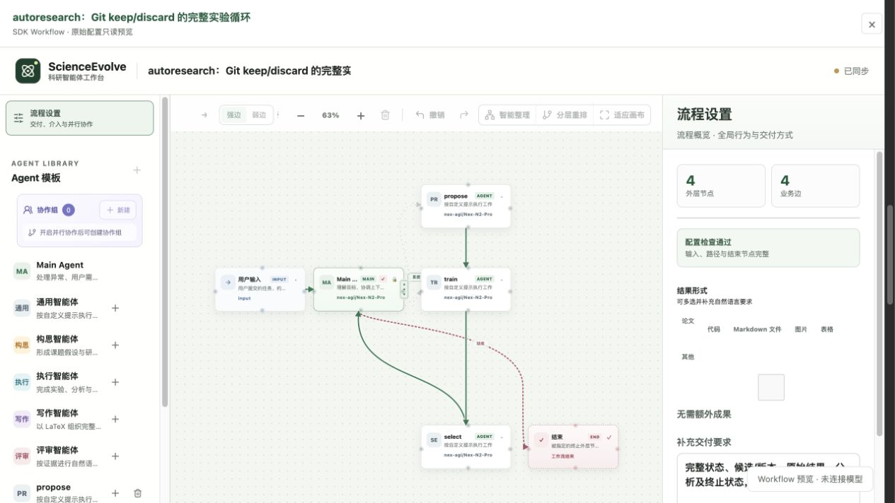

[Original Workflow JSON](../../../example/autoresearch/workflow.json) · [Requirements](../../../example/autoresearch/requirement.txt) · [Implementation notes and resources](../../../example/autoresearch/README.md)

## FunSearch

Multi-island program databases, independent sampling, actual evaluation, and periodic resets.

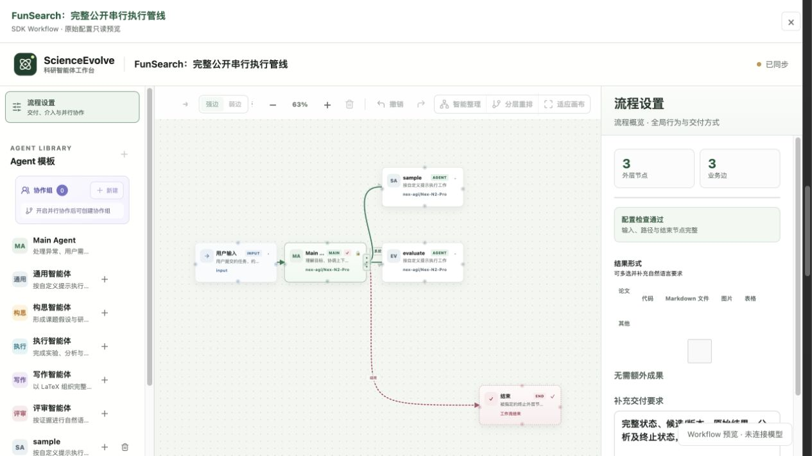

[Original Workflow JSON](../../../example/funsearch/workflow.json) · [Requirements](../../../example/funsearch/requirement.txt) · [Implementation notes and resources](../../../example/funsearch/README.md)

## Agent Laboratory

Seven research substages, code/paper solvers, and three independent reviewers.

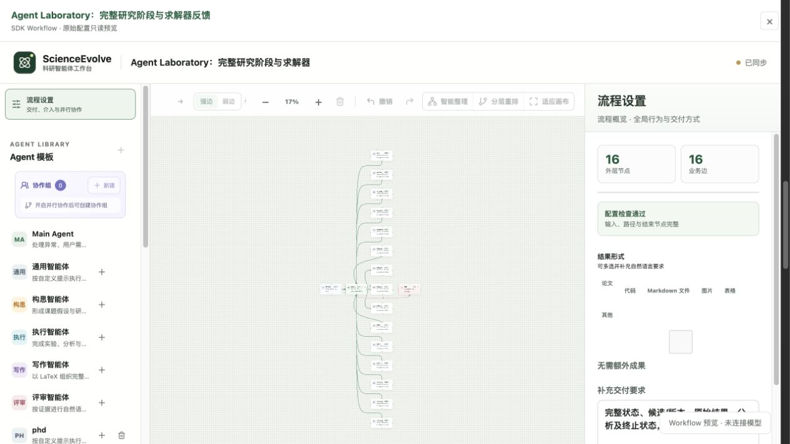

[Original Workflow JSON](../../../example/agent-laboratory/workflow.json) · [Requirements](../../../example/agent-laboratory/requirement.txt) · [Implementation notes and resources](../../../example/agent-laboratory/README.md)

## SciAgents

Graph reasoning, hypothesis refinement, scientific criticism, and independent novelty assessment.

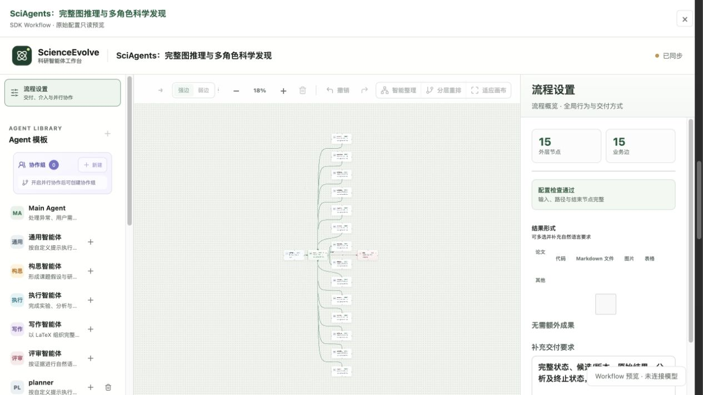

[Original Workflow JSON](../../../example/sciagents/workflow.json) · [Requirements](../../../example/sciagents/requirement.txt) · [Implementation notes and resources](../../../example/sciagents/README.md)

## Robin

Assay and candidate screening, experiment handoff, parallel analysis, and further research.

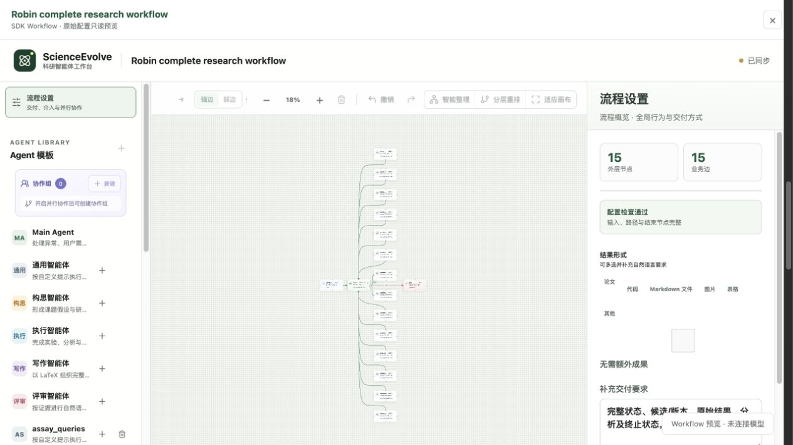

[Original Workflow JSON](../../../example/robin/workflow.json) · [Requirements](../../../example/robin/requirement.txt) · [Implementation notes and resources](../../../example/robin/README.md)

## Google AI co-scientist

Hypothesis generation, reflection, debate-based ranking, evolution, and expert feedback.

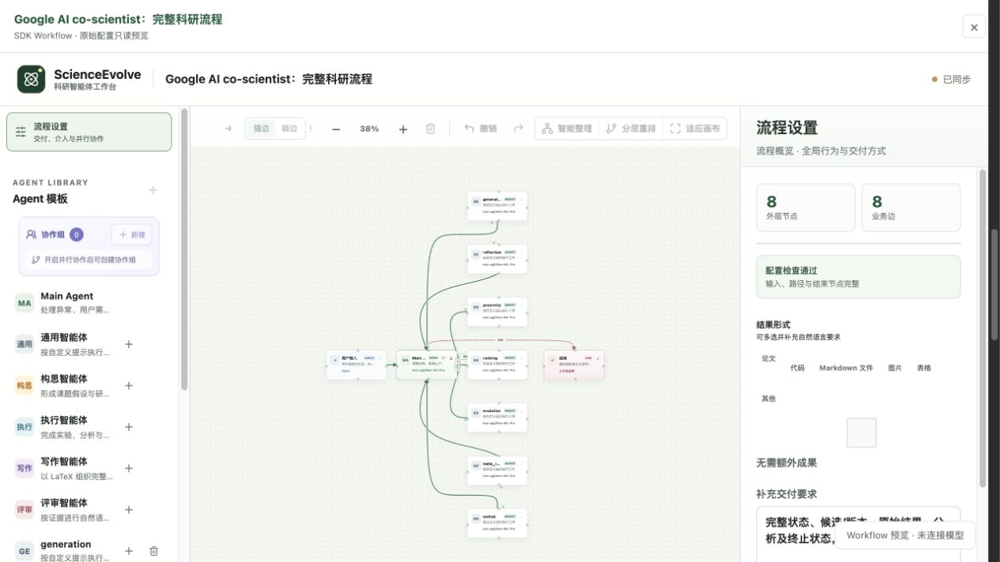

[Original Workflow JSON](../../../example/co-scientist/workflow.json) · [Requirements](../../../example/co-scientist/requirement.txt) · [Implementation notes and resources](../../../example/co-scientist/README.md)

## Biomni A1 / E1

Resource retrieval, real biological tool calls, and observation feedback.

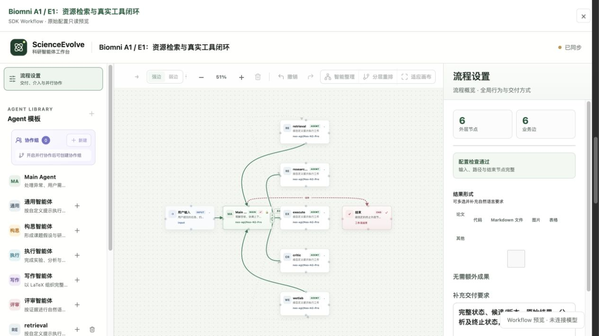

[Original Workflow JSON](../../../example/biomni/workflow.json) · [Requirements](../../../example/biomni/requirement.txt) · [Implementation notes and resources](../../../example/biomni/README.md)

## AgentRxiv

A full research laboratory with shared-preprint retrieval, publication, and cumulative research.

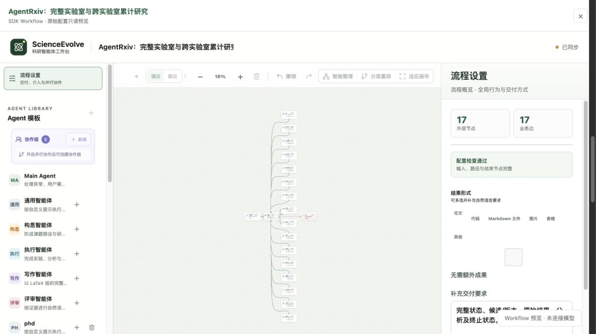

[Original Workflow JSON](../../../example/agentrxiv/workflow.json) · [Requirements](../../../example/agentrxiv/requirement.txt) · [Implementation notes and resources](../../../example/agentrxiv/README.md)

## RRSI

Harness diagnosis, candidate measurement, regularized selection, and frozen generalization evaluation.

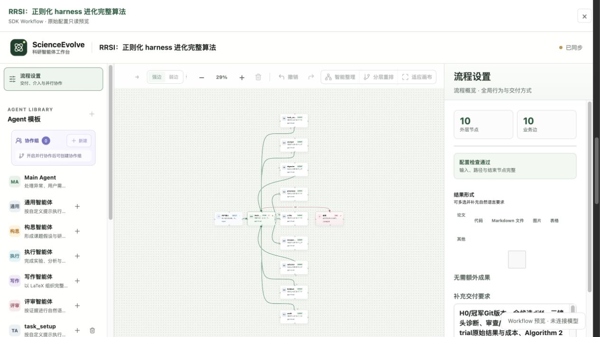

[Original Workflow JSON](../../../example/rrsi/workflow.json) · [Requirements](../../../example/rrsi/requirement.txt) · [Implementation notes and resources](../../../example/rrsi/README.md)

## DrugEvolve

Sampling, generation, implementation, training, debugging, scoring, and archiving.

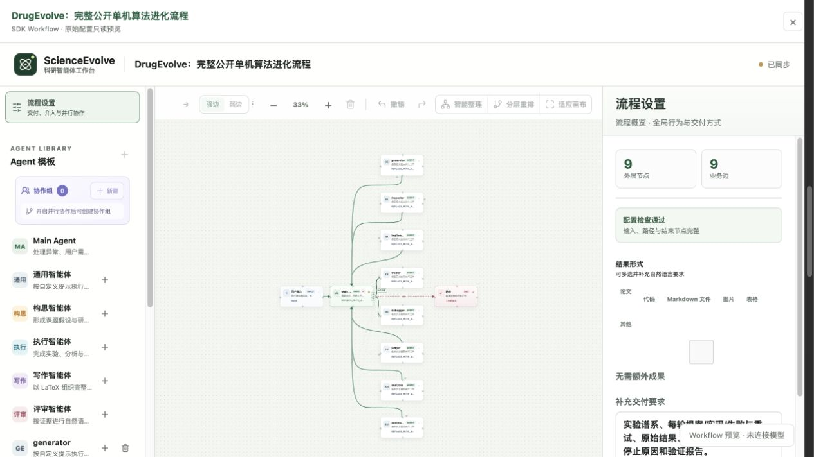

[Original Workflow JSON](../../../example/drugevolve/workflow.json) · [Requirements](../../../example/drugevolve/requirement.txt) · [Implementation notes and resources](../../../example/drugevolve/README.md)

## ScientistTwo

Idea evolution, subset/full experiments, ablations, paper writing, and review.

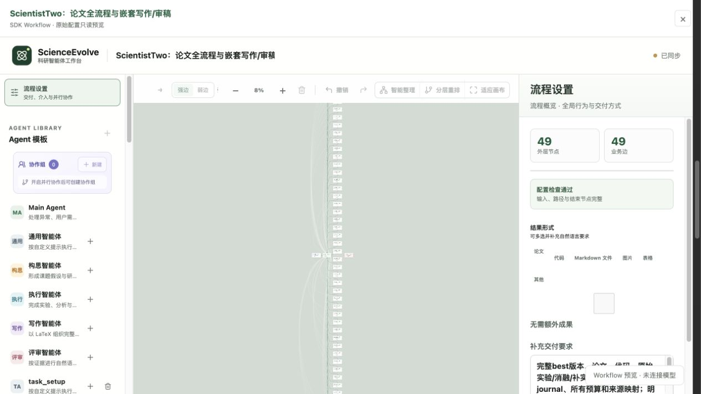

[Original Workflow JSON](../../../example/scientist-two/workflow.json) · [Requirements](../../../example/scientist-two/requirement.txt) · [Implementation notes and resources](../../../example/scientist-two/README.md)

## AI Scientist v2

Ideation, experiment management, research branches, and writing/review nodes.

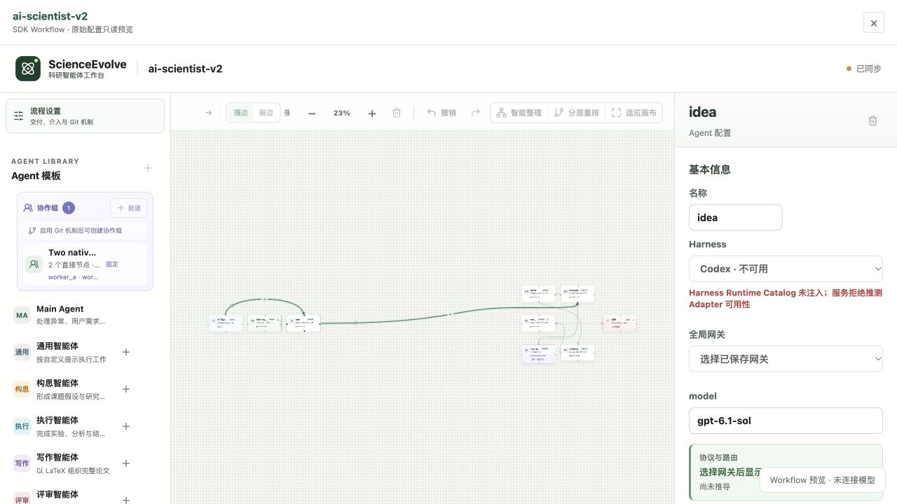

[Original Workflow JSON](../../../example/ai-scientist-v2/workflow.json) · [Requirements](../../../example/ai-scientist-v2/requirement.txt) · [Implementation notes and resources](../../../example/ai-scientist-v2/README.md)

## InternAgent 1.5

Research planning, generation, verification, and evolution.

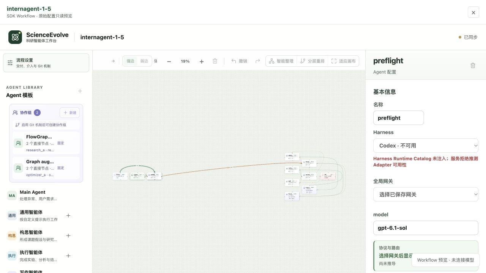

[Original Workflow JSON](../../../example/internagent-1-5/workflow.json) · [Requirements](../../../example/internagent-1-5/requirement.txt) · [Implementation notes and resources](../../../example/internagent-1-5/README.md)

## Biomni-R0

Data preparation, trajectories, rewards, training, deployment, and evaluation nodes.

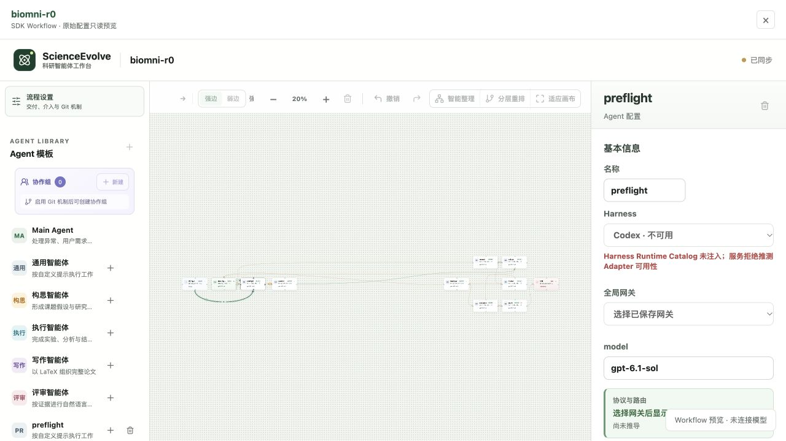

[Original Workflow JSON](../../../example/biomni-r0/workflow.json) · [Requirements](../../../example/biomni-r0/requirement.txt) · [Implementation notes and resources](../../../example/biomni-r0/README.md)

## Chemical Coscientist

Planner schedules search, documentation, code, and experiment nodes.

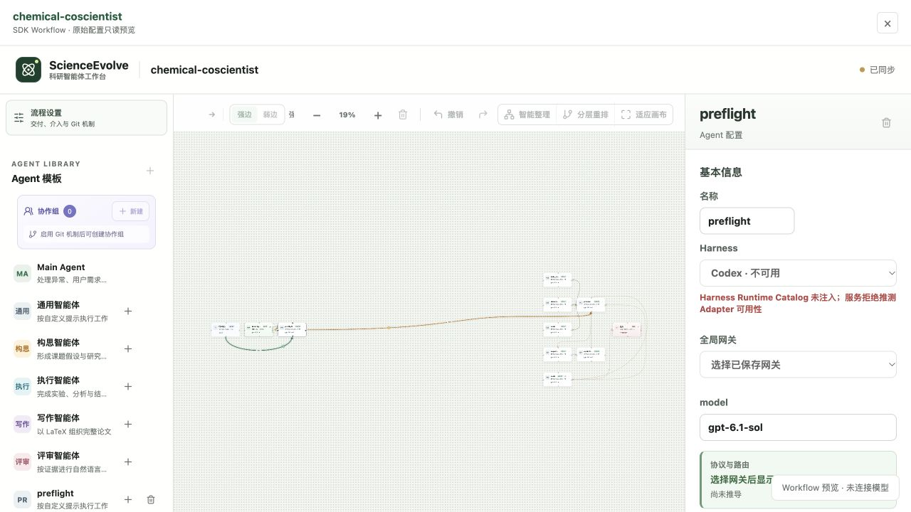

[Original Workflow JSON](../../../example/chemical-coscientist/workflow.json) · [Requirements](../../../example/chemical-coscientist/requirement.txt) · [Implementation notes and resources](../../../example/chemical-coscientist/README.md)

## Raven Host

Two specialist slots and batch decisions.

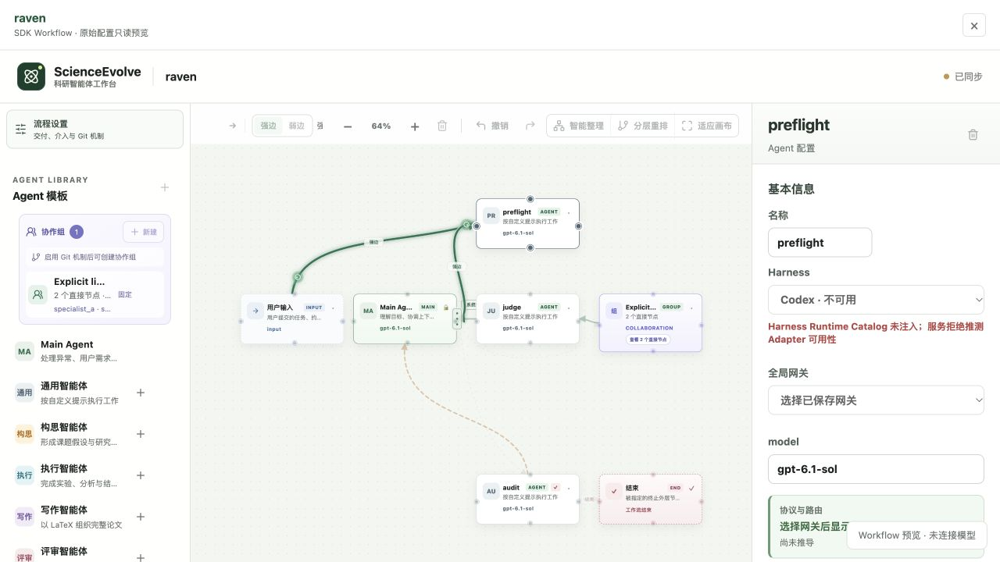

[Original Workflow JSON](../../../example/raven/workflow.json) · [Requirements](../../../example/raven/requirement.txt) · [Implementation notes and resources](../../../example/raven/README.md)
