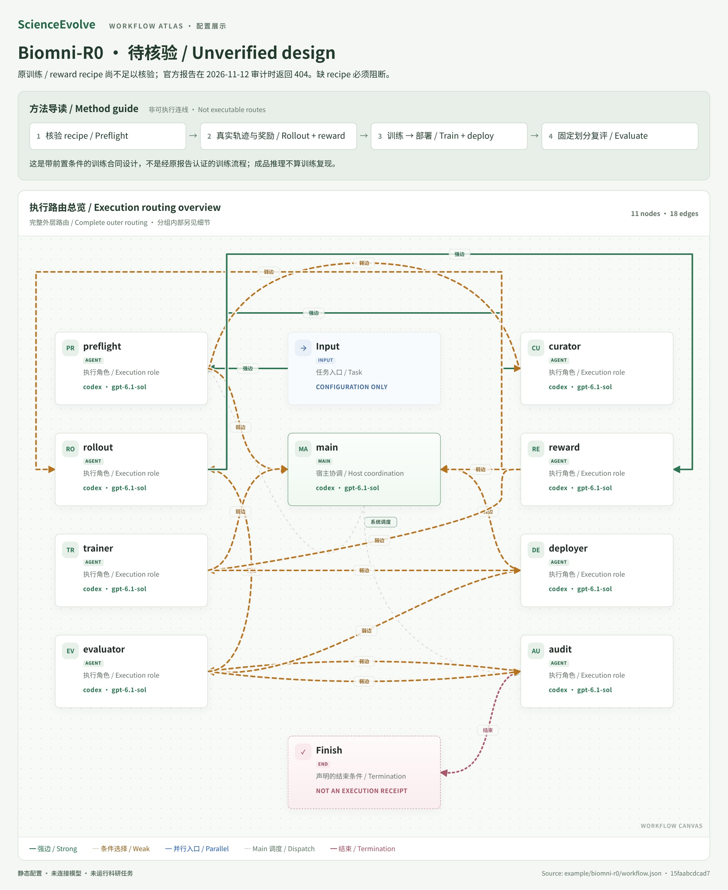

# Biomni-R0 训练 workflow 设计

[← 返回中文 README](../../README_zh-CN.md#examples) · [Back to English README](../../README.md#examples) · [示例目录](../README.md)

本例提供 [workflow.json](workflow.json) 和 [requirement.txt](requirement.txt)。使用默认 main 引擎、Git-on v3，方法 Skill 与逐角色 MCP 工具代码内嵌。

目标是轨迹、奖励、真实训练、权重部署与复评闭环；发布权重推理不能代替训练复现。本次尚未核验完整原训练/reward recipe，训练/部署/评估后端与 GPU/E1/数据资源亦待落实。缺失时 preflight 阻断，接口见[原子工具合同](https://github.com/OpenMOSS/ScienceEvolve/blob/main/scripts/example-workflows/BACKEND-CONTRACT.md)，部署变量前缀为 `SCIENCEEVOLVE_BIOMNI_R0`。

固定来源见 [SOURCES.json](https://github.com/OpenMOSS/ScienceEvolve/blob/main/example/SOURCES.json)，方法映射、资源和验收缺口见[复现度报告](https://github.com/OpenMOSS/ScienceEvolve/blob/main/docs/workflows/method-review-20261014.md)。官方报告链接在 2026-11-12 审计时返回 404；公开 model card 不足以认证具体训练方法，见[方法映射](../METHODS.md#biomni-r0)。

## 网页使用

本目录仅提供静态流程文件与资源。Web 用户按[手动使用说明](../README.md#在-web-中手动查看和使用)导出副本，再通过主页通用 JSON 导入入口查看和使用；补全需求与真实网关后自行启动。SDK 运行见 [SDK 使用指南](https://github.com/OpenMOSS/ScienceEvolve/blob/main/sdk/README_zh-CN.md)。

Status: draft. 生物医学训练与评测流程设计。

## 前端画布

真实前端组件的独立文档展示，不是完整应用窗口；**待核验训练合同设计**，未运行训练或科研任务。[方法导读与原图](../../docs/readme/workflows/biomni-r0.md)。

[查看 21 个示例的总览与细节](../../docs/readme/workflows/README.md) · [原始 Workflow JSON](workflow.json)
