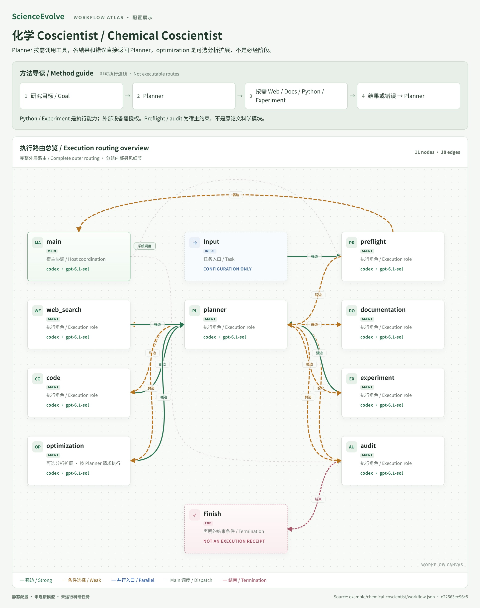

# 化学 Coscientist workflow 设计

[← 返回中文 README](../../README_zh-CN.md#examples) · [Back to English README](../../README.md#examples) · [示例目录](../README.md)

本例提供 [workflow.json](workflow.json) 和 [requirement.txt](requirement.txt)。使用默认 main 引擎、Git-on v3，方法 Skill 与逐角色 MCP 工具代码内嵌。此方法与 [Google co-scientist](../co-scientist/README.md)分开。

Planner 按需委派搜索、设备文档、代码与实验；各工具的结果和错误直接返回 Planner，再由其规划后续动作。`optimization` 是 Planner 可选委派的分析扩展，不是原论文独立必经阶段。设备匹配的编译、执行和测量服务尚待接通；历史数据或模拟不计为湿实验闭环。接口见[原子工具合同](https://github.com/OpenMOSS/ScienceEvolve/blob/main/scripts/example-workflows/BACKEND-CONTRACT.md)，部署变量前缀为 `SCIENCEEVOLVE_COSCIENTIST`。

固定来源见 [SOURCES.json](https://github.com/OpenMOSS/ScienceEvolve/blob/main/example/SOURCES.json)，方法映射、资源和验收缺口见[复现度报告](https://github.com/OpenMOSS/ScienceEvolve/blob/main/docs/workflows/method-review-20261014.md)。当前方法边界见[方法映射](../METHODS.md#chemical-coscientist)。

## 方法与执行边界

依据 [Nature 原文的系统架构与 Fig. 1](https://www.nature.com/articles/s41586-023-06792-0)：`Planner ⇄ {Web Search, Documentation, Python, Experiment}`。Python/Experiment 是执行能力，配置中的同名 Agent 负责调用与交接，不代表论文新增科学决策角色。Preflight、授权和 audit 是宿主外围约束。

## 网页使用

本目录仅提供静态流程文件与资源。Web 用户按[手动使用说明](../README.md#在-web-中手动查看和使用)导出副本，再通过主页通用 JSON 导入入口查看和使用；补全需求与真实网关后自行启动。SDK 运行见 [SDK 使用指南](https://github.com/OpenMOSS/ScienceEvolve/blob/main/sdk/README_zh-CN.md)。

Status: draft. 化学任务规划、设备执行与湿实验反馈流程设计。

## 前端画布

真实前端组件的独立文档展示，不是完整应用窗口；静态配置，未运行科研任务。[方法导读与原图](../../docs/readme/workflows/chemical-coscientist.md)。

[查看 21 个示例的总览与细节](../../docs/readme/workflows/README.md) · [原始 Workflow JSON](workflow.json)
