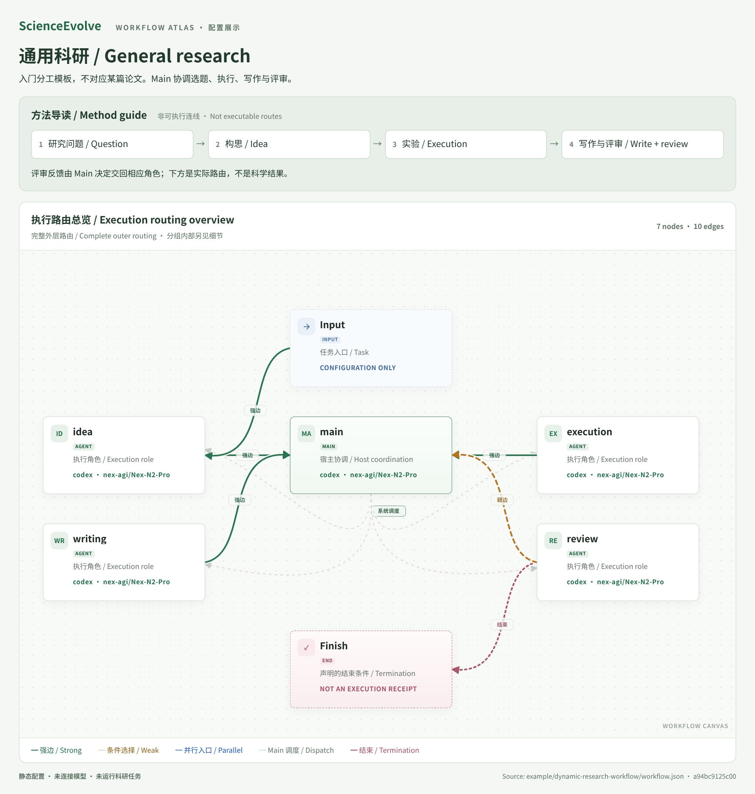

# 默认科研工作流

[← 返回中文 README](../../README_zh-CN.md#examples) · [Back to English README](../../README.md#examples) · [示例目录](../README.md)

选题、执行、写作、评审，由 Main 协调。

## Workflow 画布

真实前端组件的独立文档展示，不是完整应用窗口。画布保持 100% 缩放、标题 16 CSS px；仅展示配置，未连接模型或执行研究。

[方法导读与原图](../../docs/readme/workflows/dynamic-research-workflow.md) · [方法映射](../METHODS.md#dynamic-research-workflow)。

[原始 JSON](workflow.json) · [手动导入](../README.md#在-web-中手动查看和使用)
